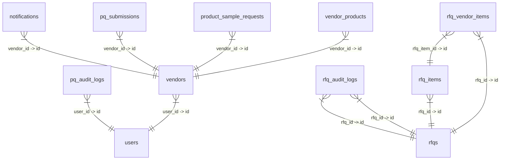

# 📘 Master System Guide: VSS & Workspace

## 📑 Table of Contents
1. [🌟 System Overview](#1--system-overview)
2. [🧭 Navigation Guide (User POV)](#2--navigation-guide-user-pov)
3. [👥 Who Uses What? (Roles & Flows)](#3--who-uses-what-roles--flows)
4. [🗄️ Database Architecture & ER Diagram](#4--database-architecture--er-diagram)
5. [⚙️ Function Hierarchy & Call Graph](#5--function-hierarchy--call-graph)
6. [🖥️ Detailed Codebase API](#6--detailed-codebase-api)

## 1. 🌟 System Overview
Our platform is split into two main areas:
### 🏢 **VSS (Vendor Sourcing System)**
- **What it does:** Allows vendors to register, log in, and manage their profiles.

### 💻 **Workspace**
- **What it does:** The internal portal for Category Managers, Engineers, and Procurement teams to evaluate vendors and manage projects.

## 2. 🧭 Navigation Guide (User POV)
This section breaks down the application from the user's perspective. It explains every page available on the sidebar menu, what it does, and which roles can access it.

### 📊 Dashboard & Overview
- **Dashboard**
  - *Accessible By:* All Internal Users (Dynamic layout based on role)
  - *What it does:* The central hub of the Workspace. Category Managers and PICs see their ticket workload and SLA warnings. Project Directors and QS see their project budgets and active PRs. STC sees supply chain metrics.
- **Announcements**
  - *Accessible By:* All Internal Users
  - *What it does:* Displays global systemic announcements or team-wide messages from management.

### ⚙️ Operations
- **Upload PRs & AI**
  - *Accessible By:* Category Manager
  - *What it does:* Allows bulk upload of Purchase Requests. Triggers the internal AI to automatically extract items, match them with Master Data, and auto-assign them to procurement teams.
- **Vendor Evaluations**
  - *Accessible By:* Category Manager, Manager
  - *What it does:* A review portal to check incoming Vendor Evaluation scores, see compliance statuses, and manually assign specific Question Sets to Purchase Orders.

### 🤝 Sourcing
- **Create RFQ**
  - *Accessible By:* Category Manager, Manager, PIC
  - *What it does:* A form to manually generate a new Request for Quotation (RFQ) to send out to vendors for bidding.
- **RFQ Dashboard**
  - *Accessible By:* Category Manager, Manager, PIC, Project Director, QS
  - *What it does:* The primary workspace for managing active, drafted, and closed RFQs. Users can compare vendor bids here.
- **Team RFQ Monitoring**
  - *Accessible By:* Category Manager, Manager, Project Director, QS
  - *What it does:* A read-only, high-level overview for team leaders to monitor the progress and status of all RFQs across their respective teams.

### 📦 AON (Agreement Order Network)
- **Master AON**
  - *Accessible By:* STC, Category Manager, Manager
  - *What it does:* The centralized table for managing long-term pricing agreements and supplier allocations.
- **Upload AON**
  - *Accessible By:* STC, Category Manager, Manager
  - *What it does:* Bulk upload tool for ingesting new AON references via Excel/CSV.
- **Repeat Purchase Alert**
  - *Accessible By:* STC, Category Manager, Manager
  - *What it does:* Automatically flags and warns procurement teams if they are repeatedly buying identical items without a long-term contract.

### 📈 Analytics
- **Cost Avoidance**
  - *Accessible By:* Category Manager, Manager
  - *What it does:* Financial dashboards that track soft savings generated through negotiation *before* a Purchase Order is issued.
- **Cost Savings**
  - *Accessible By:* Category Manager, Manager, STC
  - *What it does:* Hard financial dashboards tracking actualized cost savings against predefined baseline budgets.
- **SLA Tracking**
  - *Accessible By:* Category Manager, Manager
  - *What it does:* Operational metrics that monitor turnaround times and bottleneck delays for the procurement team to ensure PRs are handled promptly.

### 🛠️ Configuration
- **Master Data**
  - *Accessible By:* Category Manager, Manager, PIC
  - *What it does:* The core repository for SKUs, product dictionaries, items, and mapping records. Central source of truth for the system.
- **SKU Dictionary**
  - *Accessible By:* All Internal Users
  - *What it does:* A searchable taxonomy dictionary used to find correct naming structures for items.
- **PGroup Setup**
  - *Accessible By:* Category Manager, Manager
  - *What it does:* Interface to define Purchasing Groups and map them to their appropriate procurement teams.
- **Master Vendor Evaluation**
  - *Accessible By:* Category Manager
  - *What it does:* Configuration portal to build and edit Question Sets, individual Questions, and criteria for the Vendor Evaluation system.
- **Maintenance Settings**
  - *Accessible By:* Category Manager
  - *What it does:* Administrative controls, including putting the system into Maintenance Mode.

## 3. 👥 Who Uses What? (Roles & Flows)
## 4. 🗄️ Database Architecture & ER Diagram
### Database Relationships (ERD)

### All Database Tables
| 📁 Table Name | Key Information Stored |
| :--- | :--- |
| `holidays` | id, holiday_date, holiday_name, type, created_by, created_at, ), LOCK, INSERT |
| `notifications` | id, type, triggered_by, vendor_id, recipient_id, channel, status, is_read, message, payload, sent_at, created_at, ), LOCK, INSERT |
| `pq_answers` | id, submission_id, question_id, selected_score, attachment_path, remarks, needs_revision, reviewer_notes, vm_notes, vm_flag, vm_row_notes, vm_needs_revision, reviewer_id, ), LOCK, INSERT |
| `pq_audit_logs` | id, submission_id, question_id, user_id, action_detail, created_at, ), LOCK, INSERT |
| `pq_questions` | id, section_id, variant_target, question_text, help_text, is_active, ), LOCK, INSERT |
| `pq_sections` | id, section_name, sort_order, ), LOCK, INSERT |
| `pq_sla_logs` | id, submission_id, leg_number, sourcing_submitted_at, sourcing_reviewer_id, sla_deadline, vm_action_at, vm_action_type, vm_reviewer_id, working_hours_elapsed, sla_met, created_at, ), LOCK, INSERT |
| `pq_submissions` | id, vendor_id, status, total_weighted_score, max_possible_weighted_score, risk_percentage, risk_category, sourcing_reviewer_id, sourcing_notes, vm_reviewer_id, vm_notes, submitted_at, approved_at, pq_sla_deadline, pq_sla_first_forward_at, pq_sla_final_hours, pq_sla_final_met, ), LOCK, INSERT |
| `pq_weight` | id, question_id, sub_variant_target, weight, help_text, ), LOCK, INSERT |
| `product_sample_requests` | id, vendor_id, product_id, requested_by, request_note, status, created_at, ), LOCK, UNLOCK, DROP, CREATE, id, pillar, tower, category, sub_category_code, sub_category, commodity, created_at, ), LOCK, INSERT |
| `users` | id, name, email, phone_number, role, manager_username, username, password, created_at, ), LOCK, INSERT |
| `vendor_products` | id, vendor_id, item_name, brand, description, moq, uom, price_idr, product_image, is_active, created_at, category, sub_category, commodity, add_info, ), LOCK, INSERT |
| `vendors` | id, user_id, company_name, company_type, core_business, legal_entity_type, sub_company_type, email, registration_status, k2_status, k2_request_number, k2_remarks, sla_deadline, sla_status, vendor_code, k2_started_at, k2_registered_at, k2_registered_by, admin_notes, nib_number, contact_person, pic_finance, email_pic_finance, phone, bank_name, bank_branch, bank_account_number, bank_holder_name, goods_services_list, created_at, updated_at, nib_path, bank_cover_path, bank_account_status, npwp_path, sppkp_path, is_sppkp, registration_file, director_name, director_phone, establishment_date, company_profile_file, deed_of_establishment_file, deed_of_establishment_number, deed_of_establishment_status, deed_of_amendment_file, decree_of_legal_entity_file, decree_of_legal_entity_number, decree_of_legal_entity_status, business_entity_cert_file, director_id_card_file, director_id_number, director_id_status, npwp_number, nib_status, npwp_status, npwp_name, company_address, business_ethics_commitment_file, ), LOCK, INSERT |
| `admin_mappings` | id, p_org, pic_name, created_at, ), LOCK, INSERT |
| `allowed_pgroups` | pgroup_code, status, suggested_by, ), LOCK, INSERT |
| `company_holidays` | id, holiday_date, description, ), LOCK, INSERT |
| `master_data` | id, level_0, level_1, level_2, level_3, level_4, pic_names, suggested_pic_names, suggested_by, ), LOCK, INSERT |
| `pgroup_team_mappings` | id, p_group, team_name, pic_name, ), LOCK, INSERT |
| `pic_team_mappings` | id, pic_name, team_name, ), LOCK, INSERT |
| `prs` | ticket_no, ticket_line_item, sku, p_org, p_group, pr_date, requestor_name, site_allocation, ticket_type, status_ticket, canvassing_no, canvassing_date, po_number, po_amount, po_currency, baseline_price, baseline_currency, vendor_name, qty, uom, delivery_date, gr_date, item_description, assigned_pic, assigned_by_ai, gp_officer, created_at, tr_date_gp, canvassing_date_approver_1, pillar, ), LOCK, INSERT |
| `purchases_2025` | ticket_no, ticket_type, status_ticket, p_org, p_group, ticket_line_item, tr_date_technical, tr_date_gp, solver, gp_officer, site_allocation, canvassing_no, status_canvassing, canvassing_date, po_number, status_po, vendor_name, sku, item_description, qty, uom, po_amount, delivery_date, ), LOCK, INSERT |
| `requestors` | id, requestor_name, email, whatsapp_number, ), LOCK, INSERT |
| `rfq_audit_logs` | id, rfq_id, username, action_type, target_vendor_id, created_at, ), LOCK, UNLOCK, DROP, CREATE, id, rfq_id, username, has_opened, opened_at, ), LOCK, INSERT |
| `rfq_committee_template_users` | id, template_id, username, ), LOCK, INSERT |
| `rfq_committee_templates` | id, template_name, created_by, created_at, ), LOCK, INSERT |
| `rfq_items` | id, rfq_id, ticket_no, ticket_line_item, item_description, qty, uom, ), LOCK, INSERT |
| `rfq_vendor_items` | id, rfq_vendor_id, rfq_item_id, price, lead_time, remarks, ), LOCK, UNLOCK, DROP, CREATE, id, rfq_id, vendor_name, vendor_email, vendor_wa, vendor_pic, secret_password, total_price, ppn_status, price_validity, file_cover_letter, file_boq, file_supporting, submitted_at, ), LOCK, INSERT |
| `rfqs` | id, package_name, deadline, status, created_by, created_at, winner_vendor_id, final_price, closed_by, closed_at, parent_id, round_number, rfq_type, ), LOCK, INSERT |
| `sync_db_prs_for_worklist___new_users` | COL, COL, COL, COL, COL, COL, COL, COL, COL, ), LOCK, INSERT |
| `system_settings` | setting_key, setting_value, ), LOCK, INSERT |
| `tax_rules` | p_org_prefix, is_inclusive_ppn, ), LOCK, INSERT |

## 5. ⚙️ Function Hierarchy & Call Graph
### Core System Function Flows
This diagram maps out how key functions interact and call one another internally.

```mermaid
graph TD
    importSqlFile --> close
    recalculate_all_quantitative_scores --> calculate_otf_score
    require_manager --> require_login
    require_category_manager --> require_login
    sendTenderEmail --> isSMTP
    sendTenderEmail --> isHTML
    sendTenderEmail --> send
    sendTenderEmail --> addCC
    sendTenderEmail --> setFrom
    sendTenderEmail --> addAddress
    ve2_invite_log_exists --> ve2_redact_secrets
    send_rfq_notifications --> sendFonnteWA
    send_rfq_notifications --> sendTenderEmail
    notify_new_rfq --> get_rfq_recipients
    notify_new_rfq --> send_rfq_notifications
    notify_seal_opened --> send_rfq_notifications
    notify_seal_opened --> get_rfq_recipients
    notify_seal_completely_opened --> send_rfq_notifications
    notify_seal_completely_opened --> get_rfq_recipients
    notify_all_vendors_submitted --> send_rfq_notifications
    notify_all_vendors_submitted --> get_rfq_recipients
    notify_deadline_reminder --> get_rfq_recipients
    notify_deadline_reminder --> send_rfq_notifications
    notify_post_deadline_reminder --> send_rfq_notifications
    notify_post_deadline_reminder --> get_rfq_recipients
    aon_parse_qty_string --> aon_parse_number
    parse_and_insert_dual_aon --> aon_parse_qty_string
    parse_and_insert_dual_aon --> aon_parse_date
    parse_and_insert_dual_aon --> aon_parse_number
    parse_and_insert_dual_aon --> aon_build_2025_pairs
    parse_and_insert_dual_aon --> aon_resolve_vendor_price
    parse_and_insert_csv --> calculate_otf_score
    renderAnnouncementDropdown --> escapeAnnouncementText
    renderAnnouncementDropdown --> confidentialityClass
    aon_can_access --> aon_allowed_roles
    aon_resolve_vendor_price --> reset
    announcement_time_ago --> announcement_format_datetime
    announcement_sanitize_content --> announcement_sanitize_url
    announcement_unread_count --> announcement_accessible_confidentialities
    announcement_send_wa_on_publish --> announcement_build_wa_message
    announcement_send_wa_on_publish --> sendFonnteGroup
    parse_and_insert_masterplan --> mp_clean_sku
    parse_and_insert_masterplan --> mp_parse_validity
    parse_and_insert_masterplan --> mp_clean_number
    parse_and_insert_csv --> calculate_otf_score
    fonnteLog --> fonnteRedact
    sendFonnteWA --> fonnteLog
    mailer --> configure
    configure --> applyConfig
    configure --> parseDSN
    parseDSN --> parseUrl
    applyConfig --> isSendmail
    applyConfig --> isSMTP
    applyConfig --> isQmail
    applyConfig --> configureSMTP
    applyConfig --> isMail
    applyConfig --> configureOptions
    __destruct --> smtpClose
    mailPassthru --> encodeHeader
    mailPassthru --> edebug
    mailPassthru --> secureHeader
    mailPassthru --> mail
    isSendmail --> parseSendmailPath
    isQmail --> parseSendmailPath
    addAddress --> addOrEnqueueAnAddress
    addCC --> addOrEnqueueAnAddress
    addBCC --> addOrEnqueueAnAddress
    addReplyTo --> addOrEnqueueAnAddress
    addOrEnqueueAnAddress --> lang
    addOrEnqueueAnAddress --> edebug
    addOrEnqueueAnAddress --> idnSupported
    addOrEnqueueAnAddress --> setError
    addOrEnqueueAnAddress --> has8bitChars
    setBoundaries --> generateId
    addAnAddress --> lang
    addAnAddress --> edebug
    addAnAddress --> validateAddress
    addAnAddress --> setError
    parseAddresses --> lang
    parseAddresses --> validateAddress
    parseAddresses --> decodeHeader
    parseAddresses --> parseSimplerAddresses
    parseSimplerAddresses --> lang
    parseSimplerAddresses --> validateAddress
    parseSimplerAddresses --> decodeHeader
    parseSimplerAddresses --> parseEmailString
    setFrom --> idnSupported
    setFrom --> validateAddress
    setFrom --> lang
    setFrom --> send
    setFrom --> edebug
    setFrom --> setError
    setFrom --> has8bitChars
    punyencodeAddress --> idnSupported
    punyencodeAddress --> has8bitChars
    send --> postSend
    send --> setError
    send --> preSend
    preSend --> encodeHeader
    preSend --> validateAddress
    preSend --> edebug
    preSend --> addressHasUnicodeLocalPart
    preSend --> headerLine
    preSend --> normalizeBreaks
    preSend --> anyAddressHasUnicodeLocalPart
    preSend --> isPermittedPath
    preSend --> createBody
    preSend --> createHeader
    preSend --> addrAppend
    preSend --> setError
    preSend --> DKIM_Add
    preSend --> stripTrailingWSP
    preSend --> setLE
    preSend --> secureHeader
    preSend --> lang
    preSend --> setMessageType
    preSend --> alternativeExists
    preSend --> punyencodeAddress
    preSend --> mail
    postSend --> reset
    postSend --> edebug
    postSend --> connected
    postSend --> setError
    postSend --> smtpSend
    postSend --> sendmailSend
    postSend --> mailSend
    sendmailSend --> doCallback
    sendmailSend --> lang
    sendmailSend --> edebug
    sendmailSend --> validateAddress
    sendmailSend --> isShellSafe
    sendmailSend --> parseAddresses
    sendmailSend --> stripTrailingWSP
    isShellSafe --> mail
    fileIsAccessible --> isPermittedPath
    mailSend --> doCallback
    mailSend --> lang
    mailSend --> validateAddress
    mailSend --> addrFormat
    mailSend --> isShellSafe
    mailSend --> mailPassthru
    mailSend --> parseAddresses
    mailSend --> preSend
    mailSend --> stripTrailingWSP
    smtpSend --> reset
    smtpSend --> getLastTransactionID
    smtpSend --> smtpConnect
    smtpSend --> doCallback
    smtpSend --> setError
    smtpSend --> xclient
    smtpSend --> preSend
    smtpConnect --> edebug
    smtpClose --> quit
    setLanguage --> connect
    getTranslations --> setLanguage
    addrAppend --> addrFormat
    addrFormat --> secureHeader
    wrapText --> utf8CharBoundary
    setWordWrap --> wrapText
    createHeader --> encodeHeader
    getMailMIME --> headerLine
    getSentMIMEMessage --> stripTrailingWSP
    createBody --> attachAll
    getBoundaries --> setBoundaries
    getBoundary --> headerLine
    setMessageType --> alternativeExists
    addAttachment --> lang
    attachAll --> encodeHeader
    encodeFile --> lang
    encodeString --> lang
    encodeHeader --> wrapText
    encodeQP --> normalizeBreaks
    addStringAttachment --> lang
    addEmbeddedImage --> lang
    addStringEmbeddedImage --> lang
    clearAddresses --> clearQueuedAddresses
    clearCCs --> clearQueuedAddresses
    clearBCCs --> clearQueuedAddresses
    replaceCustomHeader --> lang
    setError --> lang
    serverHostname --> isValidHost
    anyAddressHasUnicodeLocalPart --> addressHasUnicodeLocalPart
    lang --> setLanguage
    getSmtpErrorMessage --> lang
    addCustomHeader --> lang
    msgHTML --> normalizeBreaks
    filenameToType --> _mime_types
    set --> lang
    DKIM_Sign --> lang
    DKIM_HeaderC --> normalizeBreaks
    DKIM_BodyC --> normalizeBreaks
    DKIM_Add --> normalizeBreaks
```

## 6. 🖥️ Detailed Codebase API
### 📄 `register.php`
- **Functions Inside:**
  - `syncPhone()` - *Performs internal processing or utility operations.*
  - `setupToggle(toggleBtn, inputEl)` - *Performs internal processing or utility operations.*
  - `validatePassword()` - *Performs internal processing or utility operations.*

### 📄 `reset_password.php`
- **Functions Inside:**
  - `validate()` - *Performs internal processing or utility operations.*

### 📄 `config.php`
- **Functions Inside:**
  - `getWorkspaceConnection(): ?mysqli {
    $ws_host = getenv('DB_HOST') ?: 'localhost';
    $is_qa   = (strpos(__DIR__, '/qa/') !== false || strpos($_SERVER['REQUEST_URI'] ?? '', '/qa/') !== false);
    $ws_db   = $is_qa ? 'u894129685_workspace_qa' : 'u894129685_workspace';

    $ws = @new mysqli($ws_host, 'u894129685_workspace007', 'Xcel007!', $ws_db);
    if ($ws->connect_error)` - *Performs internal processing or utility operations.*

### 📄 `detail_view.php`
- **Functions Inside:**
  - `getCheck($val)` - *Performs internal processing or utility operations.*

### 📄 `register_action.php`
- **Functions Inside:**
  - `uploadFile($file_input_name, $target_dir, $vendor_id, $prefix, $max_mb = 5)` - *Performs internal processing or utility operations.*

### 📄 `workspace/import_db.php`
- **Functions Inside:**
  - `importSqlFile($host, $db, $user, $pass, $filepath)` - *Calls internal functions (close).*

### 📄 `workspace/config/database.php`
- **Functions Inside:**
  - `get_vss_pdo(): PDO {
    $db_host = getenv('DB_HOST') ?: "localhost";
    if (php_sapi_name() === 'cli-server')` - *Performs internal processing or utility operations.*

### 📄 `workspace/config/gemini_api.php`
- **Functions Inside:**
  - `call_gemini_api($prompt, $maxRetries = 3)` - *Performs internal processing or utility operations.*

### 📄 `workspace/includes/vendor_eval_v2_fonnte.php`
- **Functions Inside:**
  - `ve2_fonnte_local_config(): array
{
    if (!is_file(VE2_FONNTE_LOCAL_CONFIG))` - *Performs internal processing or utility operations.*
  - `ve2_fonnte_token(): string
{
    $env = getenv('VE2_FONNTE_TOKEN');
    if (is_string($env) && trim($env) !== '')` - *Performs internal processing or utility operations.*
  - `ve2_fonnte_sender_number(): string
{
    $cfg = ve2_fonnte_local_config();
    return isset($cfg['sender_number']) ? trim((string)$cfg['sender_number']) : '';
}

/** Mask a phone number for logs: 6281*****734. Independent copy so this file has no
 *  load-order dependency on vendor_eval_v2_sender.php's ve2_mask_phone(). */
function ve2_fonnte_mask_phone(string $wa): string
{
    $d = preg_replace('/\D+/', '', $wa);
    $n = strlen($d);
    if ($n === 0)` - *Performs internal processing or utility operations.*
  - `ve2_fonnte_redact(string $text): string
{
    $token = ve2_fonnte_token();
    if ($token !== '')` - *Performs internal processing or utility operations.*
  - `ve2_send_fonnte_wa(string $target, string $message): array
{
    $result = [
        'ok'              => false,
        'http_code'       => 0,
        'curl_errno'      => 0,
        'curl_error'      => '',
        'provider_status' => null,
        'reason'          => '',
    ];

    $token = ve2_fonnte_token();
    if ($token === '')` - *Performs internal processing or utility operations.*

### 📄 `workspace/includes/quant_eval.php`
- **Functions Inside:**
  - `calculate_otf_score($gr_date, $delivery_date, $config)` - *Performs internal processing or utility operations.*
  - `recalculate_all_quantitative_scores(PDO $pdo)` - *Interacts with database (SELECT p, UPDATE prs). Calls internal functions (calculate_otf_score).*

### 📄 `workspace/includes/auth.php`
- **Functions Inside:**
  - `require_login()` - *Performs internal processing or utility operations.*
  - `require_manager()` - *Calls internal functions (require_login).*
  - `require_category_manager()` - *Calls internal functions (require_login).*
  - `get_project_head_groups($pdo, $session)` - *Interacts with database (SELECT DISTINCT).*
  - `formatJakartaDate($dateString)` - *Performs internal processing or utility operations.*
  - `get_all_subordinates($pdo, $manager_username)` - *Interacts with database (SELECT username).*

### 📄 `workspace/includes/mailer.php`
- **Functions Inside:**
  - `sendTenderEmail($to_email, $to_name, $subject, $message_body, $is_html = false, $cc = null)` - *Calls internal functions (isSMTP, isHTML, send, addCC, setFrom, addAddress).*

### 📄 `workspace/includes/vendor_eval_v2_sender.php`
- **Functions Inside:**
  - `ve2_mask_phone(string $wa): string
{
    $d = preg_replace('/\D+/', '', $wa);
    $n = strlen($d);
    if ($n === 0)` - *Performs internal processing or utility operations.*
  - `ve2_redact_secrets(string $text): string
{
    if (defined('FONNTE_TOKEN') && FONNTE_TOKEN !== '')` - *Performs internal processing or utility operations.*
  - `ve2_new_run_id(string $label = 'cli'): string
{
    $label = preg_replace('/[^a-z0-9_]/i', '', $label) ?: 'run';
    return date('Ymd_His') . '_' . $label . '_' . bin2hex(random_bytes(4));
}

// ── CSRF (session-scoped; used by dashboard_mgr.php + ajax_send_wa.php) ──────

function ve2_csrf_token(): string
{
    if (session_status() !== PHP_SESSION_ACTIVE)` - *Performs internal processing or utility operations.*
  - `ve2_csrf_check(string $submitted): bool
{
    return $submitted !== ''
        && !empty($_SESSION['_csrf_ve2_web'])
        && hash_equals($_SESSION['_csrf_ve2_web'], $submitted);
}

// ── URL construction ─────────────────────────────────────────────────────────

/** The one and only worklist link shape. */
function ve2_worklist_url(string $base_url, string $token): string
{
    return rtrim($base_url, '/') . '/public_eval_v2_worklist.php?token=' . urlencode($token);
}

/** Validate base URL shape. Returns a list of hard errors (empty = ok). */
function ve2_base_url_errors(string $base_url, bool $is_production): array
{
    $errs = [];
    $is_localhost = str_contains($base_url, 'localhost') || str_contains($base_url, '127.0.0.1');

    if ($is_production && $is_localhost)` - *Performs internal processing or utility operations.*
  - `ve2_web_base_url(): string
{
    if (defined('VE2_PUBLIC_BASE_URL') && VE2_PUBLIC_BASE_URL !== '')` - *Performs internal processing or utility operations.*
  - `ve2_load_taxonomy_map(PDO $pdo): array
{
    $rows = $pdo->query("
        SELECT qs.id, qs.set_code, qs.set_name, m.map_level, m.taxonomy_level_2, m.taxonomy_level_3
          FROM vendor_eval_question_set_taxonomy_map m
          JOIN vendor_eval_question_sets qs ON qs.id = m.question_set_id
         WHERE qs.is_active = 1 AND m.is_active = 1
    ")->fetchAll(PDO::FETCH_ASSOC);

    $l3 = [];
    $l2 = [];
    $default = null;
    foreach ($rows as $m)` - *Performs internal processing or utility operations.*
  - `ve2_resolve_set(string $l2, ?string $l3, array $l3map, array $l2map, ?array $default): ?array
{
    $l2 = trim($l2);
    $l3 = trim((string)$l3);
    if ($l3 !== '' && isset($l3map[$l2 . '||' . $l3]))` - *Performs internal processing or utility operations.*
  - `ve2_build_wa_message(string $name, int $pending, array $po_numbers, string $worklist_url, array $opt = []): string
{
    $footer   = (string)($opt['footer'] ?? '');
    $max_list = array_key_exists('max_list', $opt) ? (int)$opt['max_list'] : 5;

    $shown  = ($max_list > 0) ? array_slice($po_numbers, 0, $max_list) : $po_numbers;
    $hidden = count($po_numbers) - count($shown);

    $pos_text = implode("\n", array_map(fn($po) => "  • {$po}", $shown));
    if ($hidden > 0)` - *Performs internal processing or utility operations.*
  - `ve2_build_email(string $name, int $pending, array $po_rows, string $worklist_url, array $opt = []): array
{
    $subject    = (string)($opt['subject'] ?? "Vendor Evaluation Required - {$pending} PO Pending");
    $footer     = (string)($opt['footer'] ?? '');
    $max_rows   = array_key_exists('max_rows', $opt) ? (int)$opt['max_rows'] : 10;
    $is_test    = (bool)($opt['is_test'] ?? false);
    $orig_email = (string)($opt['orig_email'] ?? '');
    $mgr_mail   = (string)($opt['mgr_mail'] ?? '');
    $test_email = (string)($opt['test_email'] ?? '');

    $shown  = ($max_rows > 0) ? array_slice($po_rows, 0, $max_rows) : $po_rows;
    $hidden = count($po_rows) - count($shown);

    $po_table_rows = '';
    foreach ($shown as $idx => $po_row)` - *Performs internal processing or utility operations.*
  - `ve2_build_send_plan(PDO $pdo, array $po_numbers, string $base_url, string $channel = 'both'): array
{
    $wanted = [];
    foreach ($po_numbers as $po)` - *Performs internal processing or utility operations.*
  - `ve2_invite_log_exists(PDO $pdo): bool
{
    return count($pdo->query('SHOW TABLES LIKE ' . $pdo->quote(VE2_INVITE_LOG_TABLE))->fetchAll(PDO::FETCH_NUM)) > 0;
}

/** idempotency_key = sha256(run_id|requestor_name|channel|sorted_po_csv|message_hash).
 *  run_id is folded in deliberately: separate reminder runs for the same
 *  requestor/PO-set/body must land as separate audit rows, not collide on
 *  UNIQUE(idempotency_key). Cross-run duplicate suppression is intentionally
 *  not supported — see ve2_send_reminders(). */
function ve2_idempotency_key(string $run_id, string $name, string $channel, array $sorted_po_numbers, string $message_hash): string
{
    return hash('sha256', $run_id . '|' . $name . '|' . $channel . '|' . implode(',', $sorted_po_numbers) . '|' . $message_hash);
}

/** Upsert one audit row (unique on idempotency_key). Never throws. */
function ve2_log_invite(PDO $pdo, array $row): bool
{
    try {
        $stmt = $pdo->prepare(
            'INSERT INTO ' . VE2_INVITE_LOG_TABLE . '
                (run_id, requestor_name, channel, recipient, cc_recipient, pending_po_count,
                 po_numbers_json, message_hash, idempotency_key, status, sent_at, error_message)
             VALUES
                (:run_id,:req,:channel,:recipient,:cc,:cnt,:pos,:mhash,:idem,:status,:sent_at,:err)
             ON DUPLICATE KEY UPDATE
                run_id        = VALUES(run_id),
                status        = VALUES(status),
                sent_at       = VALUES(sent_at),
                recipient     = VALUES(recipient),
                cc_recipient  = VALUES(cc_recipient),
                error_message = VALUES(error_message)'
        );
        $stmt->execute([
            ':run_id'    => $row['run_id'],
            ':req'       => $row['requestor_name'],
            ':channel'   => $row['channel'],
            ':recipient' => $row['recipient'],
            ':cc'        => $row['cc_recipient'] ?? null,
            ':cnt'       => count($row['po_numbers']),
            ':pos'       => json_encode($row['po_numbers'], JSON_UNESCAPED_UNICODE),
            ':mhash'     => $row['message_hash'],
            ':idem'      => $row['idempotency_key'],
            ':status'    => $row['status'],
            ':sent_at'   => $row['status'] === 'sent' ? date('Y-m-d H:i:s') : null,
            ':err'       => $row['error_message'] ?? null,
        ]);
        return true;
    } catch (PDOException $e)` - *Calls internal functions (ve2_redact_secrets).*
  - `ve2_send_reminders(PDO $pdo, array $po_numbers, array $opts = []): array
{
    $base_url  = rtrim((string)($opts['base_url'] ?? ''), '/');
    $channel   = (string)($opts['channel'] ?? 'both');
    $preview   = (bool)($opts['preview'] ?? false);
    $cc_mgr    = (bool)($opts['cc_manager'] ?? false);
    $max_reqs  = (int)($opts['max_requestors'] ?? VE2_MAX_REQUESTORS_PER_RUN);
    $max_pos   = (int)($opts['max_pos'] ?? VE2_MAX_POS_PER_RUN);
    $run_id    = (string)($opts['run_id'] ?? ve2_new_run_id((string)($opts['sender_label'] ?? 'web')));

    $result = [
        'ok'               => false,
        'preview'          => $preview,
        'run_id'           => $run_id,
        'base_url'         => $base_url,
        'requestor_count'  => 0,
        'po_count'         => 0,
        'email_sent'       => 0,
        'email_failed'     => 0,
        'wa_sent'          => 0,
        'wa_failed'        => 0,
        'skipped'          => 0,
        'requestors'       => [],
        'skipped_pos'      => [],
        'errors'           => [],
        'warnings'         => [],
    ];

    if (!in_array($channel, ['both', 'email', 'wa'], true))` - *Performs internal processing or utility operations.*

### 📄 `workspace/includes/rfq_notification_helper.php`
- **Functions Inside:**
  - `get_rfq_recipients($pdo, $rfq_id)` - *Interacts with database (SELECT c, SELECT r, SELECT username).*
  - `send_rfq_notifications($users, $subject, $messageTemplate)` - *Calls internal functions (sendFonnteWA, sendTenderEmail).*
  - `notify_new_rfq($pdo, $rfq_id)` - *Calls internal functions (get_rfq_recipients, send_rfq_notifications).*
  - `notify_seal_opened($pdo, $rfq_id, $opener_username)` - *Interacts with database (SELECT name). Calls internal functions (send_rfq_notifications, get_rfq_recipients).*
  - `notify_seal_completely_opened($pdo, $rfq_id)` - *Calls internal functions (send_rfq_notifications, get_rfq_recipients).*
  - `notify_all_vendors_submitted($pdo, $rfq_id)` - *Calls internal functions (send_rfq_notifications, get_rfq_recipients).*
  - `notify_deadline_reminder($pdo, $rfq_id, $type)` - *Calls internal functions (get_rfq_recipients, send_rfq_notifications).*
  - `notify_post_deadline_reminder($pdo, $rfq_id)` - *Calls internal functions (send_rfq_notifications, get_rfq_recipients).*

### 📄 `workspace/includes/aon_parser.php`
- **Functions Inside:**
  - `aon_parse_date($raw)` - *Performs internal processing or utility operations.*
  - `aon_parse_number($raw)` - *Performs internal processing or utility operations.*
  - `aon_parse_qty_string($raw)` - *Calls internal functions (aon_parse_number).*
  - `parse_and_insert_dual_aon($catalog_path, $price_path, $imported_by = null)` - *Interacts with database (INSERT aon_skus, UPDATE aon_skus, UPDATE supply, UPDATE detail, DELETE any, INSERT sku_dictionary, SELECT sku). Calls internal functions (aon_parse_qty_string, aon_parse_date, aon_parse_number, aon_build_2025_pairs, aon_resolve_vendor_price).*

### 📄 `workspace/includes/excel_parser.php`
- **Functions Inside:**
  - `parse_and_insert_csv($file_path, $original_filename = null, $imported_by = null)` - *Interacts with database (UPDATE untuk, INSERT requestors, SELECT 1, SELECT COUNT, SELECT pgroup_code, INSERT prs, SELECT p_group, SELECT ticket_no, SELECT gp_officer_id, UPDATE status_ticket, INSERT import_batches, SELECT mv). Calls internal functions (calculate_otf_score).*

### 📄 `workspace/includes/sla_helper.php`
- **Functions Inside:**
  - `getWorkingDaysDuration($startDate, $endDate, $pdo)` - *Interacts with database (SELECT holiday_date).*

### 📄 `workspace/includes/header.php`
- **Functions Inside:**
  - `escapeAnnouncementText(value)` - *Performs internal processing or utility operations.*
  - `confidentialityClass(raw)` - *Performs internal processing or utility operations.*
  - `renderAnnouncementDropdown(data)` - *Calls internal functions (escapeAnnouncementText, confidentialityClass).*
  - `fetchAnnouncementNotifications()` - *Performs internal processing or utility operations.*

### 📄 `workspace/includes/aon_helper.php`
- **Functions Inside:**
  - `aon_allowed_roles()` - *Performs internal processing or utility operations.*
  - `aon_can_access($role)` - *Calls internal functions (aon_allowed_roles).*
  - `aon_valid_years()` - *Performs internal processing or utility operations.*
  - `aon_valid_statuses()` - *Performs internal processing or utility operations.*
  - `aon_sku_filter_sql($prs_alias = 'p')` - *Interacts with database (SELECT 1).*
  - `aon_json_error($message, $code = 422)` - *Performs internal processing or utility operations.*
  - `aon_nullable_string($value)` - *Performs internal processing or utility operations.*
  - `aon_nullable_number($value)` - *Performs internal processing or utility operations.*
  - `aon_nullable_date($value)` - *Performs internal processing or utility operations.*
  - `aon_format_datetime($dateString)` - *Performs internal processing or utility operations.*
  - `aon_resolve_vendor_price(array $raw, array $sku_vendor)` - *Calls internal functions (reset).*
  - `aon_build_2025_pairs($sku, $item_name, array $by_sku, array $by_name)` - *Performs internal processing or utility operations.*
  - `aon_alert_window_choices()` - *Performs internal processing or utility operations.*
  - `aon_get_repeat_purchase_candidates(PDO $pdo, int $window_months, int $min_count): array {
    $window_months = in_array($window_months, aon_alert_window_choices(), true) ? $window_months : 6;
    $min_count     = max(2, $min_count);
    $since         = date('Y-m-d', strtotime("-{$window_months} months"));

    // Aggregate the ad-hoc PR purchases per SKU first, then LEFT JOIN the
    // per-SKU review row afterward. aon_alert_reviews holds at most one row per
    // sku_code (UNIQUE uq_sku_code), so joining it after the GROUP BY yields the
    // exact same rows as joining before — but keeps the descriptive review
    // columns out of the aggregation, which ONLY_FULL_GROUP_BY requires (they
    // are per-SKU metadata, not grouping keys, and MySQL 8 will not treat them
    // as functionally dependent on an expression GROUP BY key like TRIM(p.sku)).
    // SKUs are grouped on TRIM(p.sku), so the grouped SKU is selected as
    // TRIM(p.sku) to match the group key exactly.
    $sql = "
        SELECT
            g.sku,
            g.item_names,
            g.purchase_count,
            g.po_count,
            g.last_purchase_date,
            g.total_qty,
            g.total_po_price,
            g.vendors,
            r.is_checked, r.review_status, r.remarks, r.checked_by, r.checked_at
        FROM (
            SELECT
                TRIM(p.sku)                                       AS sku,
                GROUP_CONCAT(p.item_description ORDER BY p.pr_date DESC SEPARATOR '||') AS item_names,
                COUNT(DISTINCT p.ticket_no)                       AS purchase_count,
                COUNT(DISTINCT p.po_number)                       AS po_count,
                MAX(p.pr_date)                                    AS last_purchase_date,
                SUM(p.qty)                                        AS total_qty,
                SUM(p.po_amount)                                  AS total_po_price,
                GROUP_CONCAT(DISTINCT p.vendor_name SEPARATOR '||') AS vendors
            FROM prs p
            WHERE p.sku IS NOT NULL AND TRIM(p.sku) != ''
              AND p.po_number IS NOT NULL AND p.po_number != ''
              AND p.qty > 0
              AND p.pr_date >= ?
              AND IFNULL(p.ticket_type, '') NOT IN ('Intercompany', 'Intercompany New Store')
              AND LOWER(IFNULL(p.status_ticket, '')) NOT LIKE '%cancel%'
              AND NOT EXISTS (
                  SELECT 1 FROM aon_skus a WHERE a.sku_code = TRIM(p.sku) AND a.is_deleted = 0
              )
            GROUP BY TRIM(p.sku)
            HAVING purchase_count >= ?
        ) g
        LEFT JOIN aon_alert_reviews r ON r.sku_code = g.sku
        ORDER BY g.purchase_count DESC, g.last_purchase_date DESC
    ";

    $stmt = $pdo->prepare($sql);
    $stmt->execute([$since, $min_count]);
    $rows = $stmt->fetchAll(PDO::FETCH_ASSOC);

    foreach ($rows as &$row)` - *Performs internal processing or utility operations.*
  - `aon_get_taxonomy_by_master_data_ids(PDO $pdo, array $master_data_ids): array {
    $ids = array_values(array_unique(array_filter(array_map('intval', $master_data_ids))));
    if (empty($ids)) return [];

    $placeholders = implode(',', array_fill(0, count($ids), '?'));
    $stmt = $pdo->prepare("SELECT id, level_0, level_1, level_2, level_3, level_4 FROM master_data WHERE id IN ($placeholders)");
    $stmt->execute($ids);

    $out = [];
    foreach ($stmt->fetchAll(PDO::FETCH_ASSOC) as $r)` - *Performs internal processing or utility operations.*
  - `aon_format_taxonomy(?array $taxonomy): ?string {
    if (!$taxonomy) return null;
    $parts = array_filter(
        [$taxonomy['level_0'] ?? '', $taxonomy['level_1'] ?? '', $taxonomy['level_2'] ?? '', $taxonomy['level_3'] ?? '', $taxonomy['level_4'] ?? ''],
        fn($v) => trim((string)$v) !== ''
    );
    return $parts ? implode(' > ', $parts) : null;
}

/**
 * Fetch the individual PO purchase line items backing aon_get_repeat_purchase_candidates()'s
 * counts, so the alert page can list each PO number and the date it purchased
 * the SKU (instead of only a total purchase count / a first→last date range).
 * Uses the same realized-purchase filters as that function.
 *
 * @param string[] $skus
 * @return array keyed by uppercased/trimmed SKU => list of
 *   ['po_number','ticket_no','pr_date','qty','vendor_name','po_amount'], newest first.
 */
function aon_get_repeat_purchase_po_rows(PDO $pdo, array $skus, string $since): array {
    $skus = array_values(array_unique(array_filter(array_map(fn($s) => trim((string)$s), $skus), fn($s) => $s !== '')));
    if (empty($skus)) return [];

    $placeholders = implode(',', array_fill(0, count($skus), '?'));
    $sql = "
        SELECT TRIM(p.sku) AS sku, p.po_number, p.ticket_no, p.pr_date, p.qty, p.vendor_name, p.po_amount
        FROM prs p
        WHERE TRIM(p.sku) IN ($placeholders)
          AND p.po_number IS NOT NULL AND p.po_number != ''
          AND p.qty > 0
          AND p.pr_date >= ?
          AND IFNULL(p.ticket_type, '') NOT IN ('Intercompany', 'Intercompany New Store')
          AND LOWER(IFNULL(p.status_ticket, '')) NOT LIKE '%cancel%'
        ORDER BY p.pr_date DESC
    ";
    $stmt = $pdo->prepare($sql);
    $stmt->execute([...$skus, $since]);

    $grouped = [];
    foreach ($stmt->fetchAll(PDO::FETCH_ASSOC) as $r)` - *Performs internal processing or utility operations.*

### 📄 `workspace/includes/announcement_helper.php`
- **Functions Inside:**
  - `announcement_current_user($pdo)` - *Interacts with database (SELECT id).*
  - `announcement_confidentiality_class($value)` - *Performs internal processing or utility operations.*
  - `announcement_accessible_confidentialities($user)` - *Performs internal processing or utility operations.*
  - `can_create_announcement($user)` - *Performs internal processing or utility operations.*
  - `announcement_escape($value)` - *Performs internal processing or utility operations.*
  - `announcement_label($value)` - *Performs internal processing or utility operations.*
  - `announcement_format_datetime($dateString)` - *Performs internal processing or utility operations.*
  - `announcement_time_ago($dateString)` - *Calls internal functions (announcement_format_datetime).*
  - `announcement_sanitize_url($url)` - *Performs internal processing or utility operations.*
  - `announcement_sanitize_content($html)` - *Calls internal functions (announcement_sanitize_url).*
  - `announcement_validate_attachment($file)` - *Performs internal processing or utility operations.*
  - `announcement_store_attachment($file, $meta)` - *Performs internal processing or utility operations.*
  - `announcement_unread_count($pdo, $userId, $user = null)` - *Interacts with database (SELECT COUNT). Calls internal functions (announcement_accessible_confidentialities).*
  - `announcement_build_wa_message(array $announcement, string $link)` - *Performs internal processing or utility operations.*
  - `announcement_send_wa_on_publish($pdo, $announcementId)` - *Interacts with database (UPDATE announcements, SELECT id). Calls internal functions (announcement_build_wa_message, sendFonnteGroup).*

### 📄 `workspace/includes/aon_masterplan_parser.php`
- **Functions Inside:**
  - `mp_parse_validity($raw)` - *Performs internal processing or utility operations.*
  - `mp_clean_sku($raw)` - *Performs internal processing or utility operations.*
  - `mp_clean_number($raw)` - *Performs internal processing or utility operations.*
  - `parse_and_insert_masterplan($csv_path, $imported_by = null)` - *Interacts with database (INSERT aon_skus, UPDATE item_name). Calls internal functions (mp_clean_sku, mp_parse_validity, mp_clean_number).*

### 📄 `workspace/includes/vendor_eval_v2_routing.php`
- **Functions Inside:**
  - `ve2_override_set(PDO $pdo, string $po): ?array
{
    $stmt = $pdo->prepare("
        SELECT qs.id, qs.set_code, qs.set_name
          FROM vendor_eval_po_question_set_override ov
          JOIN vendor_eval_question_sets qs ON qs.id = ov.question_set_id
         WHERE ov.po_number = ? AND qs.is_active = 1
         LIMIT 1
    ");
    $stmt->execute([$po]);
    $row = $stmt->fetch(PDO::FETCH_ASSOC);
    if (!$row)` - *Performs internal processing or utility operations.*
  - `ve2_load_overrides(PDO $pdo): array
{
    $rows = $pdo->query("
        SELECT ov.po_number, qs.id, qs.set_code, qs.set_name
          FROM vendor_eval_po_question_set_override ov
          JOIN vendor_eval_question_sets qs ON qs.id = ov.question_set_id
         WHERE qs.is_active = 1
    ")->fetchAll(PDO::FETCH_ASSOC);
    $out = [];
    foreach ($rows as $r)` - *Performs internal processing or utility operations.*

### 📄 `workspace/includes/project_team_helper.php`
- **Functions Inside:**
  - `load_project_team_map(PDO $pdo)` - *Interacts with database (SELECT p_group).*
  - `project_team_for($p_group, array $project_team_map)` - *Performs internal processing or utility operations.*

### 📄 `workspace/includes/excel_parser 2.php`
- **Functions Inside:**
  - `parse_and_insert_csv($file_path, $original_filename = null, $imported_by = null)` - *Interacts with database (UPDATE untuk, INSERT requestors, SELECT 1, SELECT COUNT, SELECT pgroup_code, INSERT prs, SELECT p_group, SELECT ticket_no, SELECT gp_officer_id, UPDATE status_ticket, SELECT p_org, SELECT mv, INSERT import_batches). Calls internal functions (calculate_otf_score).*

### 📄 `workspace/includes/fonnte.php`
- **Functions Inside:**
  - `fonnteRedact($text)` - *Performs internal processing or utility operations.*
  - `fonnteLog(array $ctx)` - *Calls internal functions (fonnteRedact).*
  - `sendFonnteWA($target, $message)` - *Calls internal functions (fonnteLog).*
  - `sendFonnteGroup($groupId, $message)` - *Performs internal processing or utility operations.*

### 📄 `workspace/includes/PHPMailer/DSNConfigurator.php`
- **Classes Used:** DSNConfigurator
- **Functions Inside:**
  - `mailer($dsn, $exceptions = null)` - *Calls internal functions (configure).*
  - `configure(PHPMailer $mailer, $dsn)` - *Calls internal functions (applyConfig, parseDSN).*
  - `parseDSN($dsn)` - *Calls internal functions (parseUrl).*
  - `applyConfig(PHPMailer $mailer, $config)` - *Calls internal functions (isSendmail, isSMTP, isQmail, configureSMTP, isMail, configureOptions).*
  - `configureSMTP($mailer, $config)` - *Performs internal processing or utility operations.*
  - `configureOptions(PHPMailer $mailer, $options)` - *Performs internal processing or utility operations.*
  - `parseUrl($url)` - *Performs internal processing or utility operations.*

### 📄 `workspace/includes/PHPMailer/PHPMailer.php`
- **Classes Used:** PHPMailer, debug
- **Functions Inside:**
  - `__construct($exceptions = null)` - *Performs internal processing or utility operations.*
  - `__destruct()` - *Calls internal functions (smtpClose).*
  - `mailPassthru($to, $subject, $body, $header, $params)` - *Calls internal functions (encodeHeader, edebug, secureHeader, mail).*
  - `edebug($str)` - *Performs internal processing or utility operations.*
  - `isHTML($isHtml = true)` - *Performs internal processing or utility operations.*
  - `isSMTP()` - *Performs internal processing or utility operations.*
  - `isMail()` - *Performs internal processing or utility operations.*
  - `parseSendmailPath($sendmailPath)` - *Performs internal processing or utility operations.*
  - `isSendmail()` - *Calls internal functions (parseSendmailPath).*
  - `isQmail()` - *Calls internal functions (parseSendmailPath).*
  - `addAddress($address, $name = '')` - *Calls internal functions (addOrEnqueueAnAddress).*
  - `addCC($address, $name = '')` - *Calls internal functions (addOrEnqueueAnAddress).*
  - `addBCC($address, $name = '')` - *Calls internal functions (addOrEnqueueAnAddress).*
  - `addReplyTo($address, $name = '')` - *Calls internal functions (addOrEnqueueAnAddress).*
  - `addOrEnqueueAnAddress($kind, $address, $name)` - *Calls internal functions (lang, edebug, idnSupported, setError, has8bitChars).*
  - `setBoundaries()` - *Calls internal functions (generateId).*
  - `addAnAddress($kind, $address, $name = '')` - *Calls internal functions (lang, edebug, validateAddress, setError).*
  - `parseAddresses($addrstr, $useimap = null, $charset = self::CHARSET_ISO88591)` - *Calls internal functions (lang, validateAddress, decodeHeader, parseSimplerAddresses).*
  - `parseSimplerAddresses($addrstr, $charset)` - *Calls internal functions (lang, validateAddress, decodeHeader, parseEmailString).*
  - `parseEmailString($input)` - *Performs internal processing or utility operations.*
  - `setFrom($address, $name = '', $auto = true)` - *Calls internal functions (idnSupported, validateAddress, lang, send, edebug, setError, has8bitChars).*
  - `getLastMessageID()` - *Performs internal processing or utility operations.*
  - `validateAddress($address, $patternselect = null)` - *Performs internal processing or utility operations.*
  - `idnSupported()` - *Performs internal processing or utility operations.*
  - `punyencodeAddress($address)` - *Calls internal functions (idnSupported, has8bitChars).*
  - `send()` - *Calls internal functions (postSend, setError, preSend).*
  - `preSend()` - *Calls internal functions (encodeHeader, validateAddress, edebug, addressHasUnicodeLocalPart, headerLine, normalizeBreaks, anyAddressHasUnicodeLocalPart, isPermittedPath, createBody, createHeader, addrAppend, setError, DKIM_Add, stripTrailingWSP, setLE, secureHeader, lang, setMessageType, alternativeExists, punyencodeAddress, mail).*
  - `postSend()` - *Calls internal functions (reset, edebug, connected, setError, smtpSend, sendmailSend, mailSend).*
  - `sendmailSend($header, $body)` - *Calls internal functions (doCallback, lang, edebug, validateAddress, isShellSafe, parseAddresses, stripTrailingWSP).*
  - `isShellSafe($string)` - *Calls internal functions (mail).*
  - `isPermittedPath($path)` - *Performs internal processing or utility operations.*
  - `fileIsAccessible($path)` - *Calls internal functions (isPermittedPath).*
  - `mailSend($header, $body)` - *Calls internal functions (doCallback, lang, validateAddress, addrFormat, isShellSafe, mailPassthru, parseAddresses, preSend, stripTrailingWSP).*
  - `getSMTPInstance()` - *Performs internal processing or utility operations.*
  - `setSMTPInstance(SMTP $smtp)` - *Performs internal processing or utility operations.*
  - `setSMTPXclientAttribute($name, $value)` - *Performs internal processing or utility operations.*
  - `getSMTPXclientAttributes()` - *Performs internal processing or utility operations.*
  - `smtpSend($header, $body)` - *Calls internal functions (reset, getLastTransactionID, smtpConnect, doCallback, setError, xclient, preSend, data, stripTrailingWSP, close, getServerExt, quit, recipient, getError, lang, mail).*
  - `smtpConnect($options = null)` - *Calls internal functions (edebug, startTLS, getSMTPInstance, serverHostname, authenticate, setVerp, setDebugLevel, setTimeout, connected, close, getServerExt, quit, getSmtpErrorMessage, hello, isValidHost, lang, setSMTPUTF8, connect, setDebugOutput).*
  - `smtpClose()` - *Calls internal functions (quit, connected, close).*
  - `setLanguage($langcode = 'en', $lang_path = '')` - *Calls internal functions (connect, fileIsAccessible).*
  - `getTranslations()` - *Calls internal functions (setLanguage).*
  - `addrAppend($type, $addr)` - *Calls internal functions (addrFormat).*
  - `addrFormat($addr)` - *Calls internal functions (secureHeader, encodeHeader).*
  - `wrapText($message, $length, $qp_mode = false)` - *Calls internal functions (utf8CharBoundary, normalizeBreaks).*
  - `utf8CharBoundary($encodedText, $maxLength)` - *Performs internal processing or utility operations.*
  - `setWordWrap()` - *Calls internal functions (wrapText).*
  - `createHeader()` - *Calls internal functions (encodeHeader, addrFormat, addrAppend, rfcDate, headerLine, secureHeader, serverHostname, getMailMIME, mail).*
  - `getMailMIME()` - *Calls internal functions (headerLine, textLine).*
  - `getSentMIMEMessage()` - *Calls internal functions (stripTrailingWSP).*
  - `generateId()` - *Performs internal processing or utility operations.*
  - `createBody()` - *Calls internal functions (attachAll, endBoundary, has8bitChars, headerLine, setWordWrap, setBoundaries, textLine, getMailMIME, hasLineLongerThanMax, lang, getBoundary, isError, encodeString).*
  - `getBoundaries()` - *Calls internal functions (setBoundaries).*
  - `getBoundary($boundary, $charSet, $contentType, $encoding)` - *Calls internal functions (headerLine, textLine).*
  - `endBoundary($boundary)` - *Performs internal processing or utility operations.*
  - `setMessageType()` - *Calls internal functions (alternativeExists, attachmentExists, inlineImageExists).*
  - `headerLine($name, $value)` - *Performs internal processing or utility operations.*
  - `textLine($value)` - *Performs internal processing or utility operations.*
  - `addAttachment($path,
        $name = '',
        $encoding = self::ENCODING_BASE64,
        $type = '',
        $disposition = 'attachment')` - *Calls internal functions (lang, edebug, setError, validateEncoding, fileIsAccessible, filenameToType, mb_pathinfo).*
  - `getAttachments()` - *Performs internal processing or utility operations.*
  - `attachAll($disposition_type, $boundary)` - *Calls internal functions (encodeHeader, encodeFile, isError, secureHeader, quotedString, encodeString).*
  - `encodeFile($path, $encoding = self::ENCODING_BASE64)` - *Calls internal functions (lang, edebug, setError, fileIsAccessible, encodeString).*
  - `encodeString($str, $encoding = self::ENCODING_BASE64)` - *Calls internal functions (lang, encodeQP, setError, normalizeBreaks).*
  - `encodeHeader($str, $position = 'text')` - *Interacts with database (SELECT the). Calls internal functions (wrapText, base64EncodeWrapMB, normalizeBreaks, has8bitChars, hasMultiBytes, encodeQ).*
  - `decodeHeader($value, $charset = self::CHARSET_ISO88591)` - *Performs internal processing or utility operations.*
  - `hasMultiBytes($str)` - *Performs internal processing or utility operations.*
  - `has8bitChars($text)` - *Performs internal processing or utility operations.*
  - `base64EncodeWrapMB($str, $linebreak = null)` - *Performs internal processing or utility operations.*
  - `encodeQP($string)` - *Calls internal functions (normalizeBreaks).*
  - `encodeQ($str, $position = 'text')` - *Performs internal processing or utility operations.*
  - `addStringAttachment($string,
        $filename,
        $encoding = self::ENCODING_BASE64,
        $type = '',
        $disposition = 'attachment')` - *Calls internal functions (lang, edebug, setError, validateEncoding, filenameToType, mb_pathinfo).*
  - `addEmbeddedImage($path,
        $cid,
        $name = '',
        $encoding = self::ENCODING_BASE64,
        $type = '',
        $disposition = 'inline')` - *Calls internal functions (lang, edebug, setError, validateEncoding, fileIsAccessible, filenameToType, mb_pathinfo).*
  - `addStringEmbeddedImage($string,
        $cid,
        $name = '',
        $encoding = self::ENCODING_BASE64,
        $type = '',
        $disposition = 'inline')` - *Calls internal functions (lang, edebug, setError, validateEncoding, filenameToType).*
  - `validateEncoding($encoding)` - *Performs internal processing or utility operations.*
  - `cidExists($cid)` - *Performs internal processing or utility operations.*
  - `inlineImageExists()` - *Performs internal processing or utility operations.*
  - `attachmentExists()` - *Performs internal processing or utility operations.*
  - `alternativeExists()` - *Performs internal processing or utility operations.*
  - `clearQueuedAddresses($kind)` - *Performs internal processing or utility operations.*
  - `clearAddresses()` - *Calls internal functions (clearQueuedAddresses).*
  - `clearCCs()` - *Calls internal functions (clearQueuedAddresses).*
  - `clearBCCs()` - *Calls internal functions (clearQueuedAddresses).*
  - `clearReplyTos()` - *Performs internal processing or utility operations.*
  - `clearAllRecipients()` - *Performs internal processing or utility operations.*
  - `clearAttachments()` - *Performs internal processing or utility operations.*
  - `clearCustomHeaders()` - *Performs internal processing or utility operations.*
  - `clearCustomHeader($name, $value = null)` - *Performs internal processing or utility operations.*
  - `replaceCustomHeader($name, $value = null)` - *Calls internal functions (lang).*
  - `setError($msg)` - *Calls internal functions (lang, getError).*
  - `rfcDate()` - *Performs internal processing or utility operations.*
  - `serverHostname()` - *Calls internal functions (isValidHost).*
  - `isValidHost($host)` - *Performs internal processing or utility operations.*
  - `addressHasUnicodeLocalPart($address)` - *Performs internal processing or utility operations.*
  - `anyAddressHasUnicodeLocalPart($addresses)` - *Calls internal functions (addressHasUnicodeLocalPart).*
  - `needsSMTPUTF8()` - *Performs internal processing or utility operations.*
  - `lang($key)` - *Calls internal functions (setLanguage).*
  - `getSmtpErrorMessage($base_key)` - *Calls internal functions (lang, getError).*
  - `isError()` - *Performs internal processing or utility operations.*
  - `addCustomHeader($name, $value = null)` - *Calls internal functions (lang).*
  - `getCustomHeaders()` - *Performs internal processing or utility operations.*
  - `msgHTML($message, $basedir = '', $advanced = false)` - *Calls internal functions (normalizeBreaks, isHTML, _mime_types, addStringEmbeddedImage, mb_pathinfo, cidExists, html2text, addEmbeddedImage, alternativeExists).*
  - `html2text($html, $advanced = false)` - *Performs internal processing or utility operations.*
  - `_mime_types($ext = '')` - *Performs internal processing or utility operations.*
  - `filenameToType($filename)` - *Calls internal functions (_mime_types, mb_pathinfo).*
  - `mb_pathinfo($path, $options = null)` - *Performs internal processing or utility operations.*
  - `set($name, $value = '')` - *Calls internal functions (lang, setError).*
  - `secureHeader($str)` - *Performs internal processing or utility operations.*
  - `normalizeBreaks($text, $breaktype = null)` - *Performs internal processing or utility operations.*
  - `stripTrailingWSP($text)` - *Performs internal processing or utility operations.*
  - `stripTrailingBreaks($text)` - *Performs internal processing or utility operations.*
  - `getLE()` - *Performs internal processing or utility operations.*
  - `setLE($le)` - *Performs internal processing or utility operations.*
  - `sign($cert_filename, $key_filename, $key_pass, $extracerts_filename = '')` - *Performs internal processing or utility operations.*
  - `DKIM_QP($txt)` - *Performs internal processing or utility operations.*
  - `DKIM_Sign($signHeader)` - *Calls internal functions (lang).*
  - `DKIM_HeaderC($signHeader)` - *Interacts with database (DELETE space). Calls internal functions (normalizeBreaks).*
  - `DKIM_BodyC($body)` - *Calls internal functions (normalizeBreaks, stripTrailingBreaks).*
  - `DKIM_Add($headers_line, $subject, $body)` - *Calls internal functions (normalizeBreaks, DKIM_Sign, DKIM_QP, DKIM_HeaderC, DKIM_BodyC).*
  - `hasLineLongerThanMax($str)` - *Performs internal processing or utility operations.*
  - `quotedString($str)` - *Performs internal processing or utility operations.*
  - `getToAddresses()` - *Performs internal processing or utility operations.*
  - `getCcAddresses()` - *Performs internal processing or utility operations.*
  - `getBccAddresses()` - *Performs internal processing or utility operations.*
  - `getReplyToAddresses()` - *Performs internal processing or utility operations.*
  - `getAllRecipientAddresses()` - *Performs internal processing or utility operations.*
  - `doCallback($isSent, $to, $cc, $bcc, $subject, $body, $from, $extra)` - *Performs internal processing or utility operations.*
  - `getOAuth()` - *Performs internal processing or utility operations.*
  - `setOAuth(OAuthTokenProvider $oauth)` - *Performs internal processing or utility operations.*

### 📄 `workspace/includes/PHPMailer/OAuth.php`
- **Classes Used:** OAuth
- **Functions Inside:**
  - `__construct($options)` - *Performs internal processing or utility operations.*
  - `getGrant()` - *Performs internal processing or utility operations.*
  - `getToken()` - *Calls internal functions (getGrant).*
  - `getOauth64()` - *Calls internal functions (getToken).*

### 📄 `workspace/includes/PHPMailer/SMTP.php`
- **Classes Used:** SMTP, does
- **Functions Inside:**
  - `edebug($str, $level = 0)` - *Calls internal functions (client_send).*
  - `connect($host, $port = null, $timeout = 30, $options = [])` - *Calls internal functions (edebug, connected, close, getSMTPConnection, setError, quit, get_lines).*
  - `getSMTPConnection($host, $port = null, $timeout = 30, $options = [])` - *Calls internal functions (edebug, setError).*
  - `if(strpos(PHP_OS, 'WIN') !== 0)` - *Performs internal processing or utility operations.*
  - `startTLS()` - *Calls internal functions (sendCommand).*
  - `authenticate($username,
        $password,
        $authtype = null,
        $OAuth = null)` - *Calls internal functions (sendCommand, edebug, setError, getOauth64, hmac).*
  - `hmac($data, $key)` - *Performs internal processing or utility operations.*
  - `connected()` - *Calls internal functions (edebug, close).*
  - `close()` - *Calls internal functions (edebug).*
  - `iterateLines($s)` - *Performs internal processing or utility operations.*
  - `data($msg_data)` - *Calls internal functions (sendCommand, iterateLines, recordLastTransactionID, client_send).*
  - `hello($host = '')` - *Calls internal functions (sendHello).*
  - `sendHello($hello, $host)` - *Calls internal functions (parseHelloFields, sendCommand).*
  - `parseHelloFields($type)` - *Performs internal processing or utility operations.*
  - `mail($from)` - *Calls internal functions (sendCommand).*
  - `quit($close_on_error = true)` - *Calls internal functions (sendCommand, close).*
  - `recipient($address, $dsn = '')` - *Calls internal functions (sendCommand).*
  - `xclient(array $vars)` - *Calls internal functions (sendCommand).*
  - `reset()` - *Calls internal functions (sendCommand).*
  - `sendCommand($command, $commandstring, $expect)` - *Calls internal functions (edebug, connected, setError, get_lines, client_send).*
  - `sendAndMail($from)` - *Calls internal functions (sendCommand).*
  - `verify($name)` - *Calls internal functions (sendCommand).*
  - `noop()` - *Calls internal functions (sendCommand).*
  - `turn()` - *Calls internal functions (setError, edebug).*
  - `client_send($data, $command = '')` - *Calls internal functions (edebug).*
  - `getError()` - *Performs internal processing or utility operations.*
  - `getServerExtList()` - *Performs internal processing or utility operations.*
  - `getServerExt($name)` - *Calls internal functions (setError).*
  - `getLastReply()` - *Performs internal processing or utility operations.*
  - `get_lines()` - *Interacts with database (SELECT timed, SELECT again, SELECT failed, SELECT returns). Calls internal functions (edebug, setError, getError).*
  - `setVerp($enabled = false)` - *Performs internal processing or utility operations.*
  - `getVerp()` - *Performs internal processing or utility operations.*
  - `setSMTPUTF8($enabled = false)` - *Performs internal processing or utility operations.*
  - `getSMTPUTF8()` - *Performs internal processing or utility operations.*
  - `setError($message, $detail = '', $smtp_code = '', $smtp_code_ex = '')` - *Performs internal processing or utility operations.*
  - `setDebugOutput($method = 'echo')` - *Performs internal processing or utility operations.*
  - `getDebugOutput()` - *Performs internal processing or utility operations.*
  - `setDebugLevel($level = 0)` - *Performs internal processing or utility operations.*
  - `getDebugLevel()` - *Performs internal processing or utility operations.*
  - `setTimeout($timeout = 0)` - *Performs internal processing or utility operations.*
  - `getTimeout()` - *Performs internal processing or utility operations.*
  - `errorHandler($errno, $errmsg, $errfile = '', $errline = 0)` - *Calls internal functions (setError, edebug).*
  - `recordLastTransactionID()` - *Calls internal functions (getLastReply).*
  - `getLastTransactionID()` - *Performs internal processing or utility operations.*

### 📄 `workspace/includes/PHPMailer/Exception.php`
- **Classes Used:** Exception
- **Functions Inside:**
  - `errorMessage()` - *Performs internal processing or utility operations.*

### 📄 `workspace/includes/PHPMailer/POP3.php`
- **Classes Used:** does, is, there, POP3, debug
- **Functions Inside:**
  - `popBeforeSmtp($host,
        $port = false,
        $timeout = false,
        $username = '',
        $password = '',
        $debug_level = 0)` - *Calls internal functions (authorise).*
  - `authorise($host, $port = false, $timeout = false, $username = '', $password = '', $debug_level = 0)` - *Calls internal functions (login, disconnect, connect).*
  - `connect($host, $port = false, $tval = 30)` - *Calls internal functions (getResponse, setError, checkResponse).*
  - `login($username = '', $password = '')` - *Calls internal functions (checkResponse, setError, sendString, getResponse).*
  - `disconnect()` - *Calls internal functions (sendString, getResponse).*
  - `getResponse($size = 128)` - *Performs internal processing or utility operations.*
  - `sendString($string)` - *Performs internal processing or utility operations.*
  - `checkResponse($string)` - *Calls internal functions (setError).*
  - `setError($error)` - *Performs internal processing or utility operations.*
  - `getErrors()` - *Performs internal processing or utility operations.*
  - `catchWarning($errno, $errstr, $errfile, $errline)` - *Calls internal functions (setError).*

### 📄 `workspace/pages/ajax_check_similar_sku.php`
- **Classes Used:** of

### 📄 `workspace/pages/announcement_create.php`
- **Functions Inside:**
  - `capitalizeSentences(root)` - *Performs internal processing or utility operations.*
  - `render()` - *Calls internal functions (escHtml).*
  - `escHtml(str)` - *Performs internal processing or utility operations.*

### 📄 `workspace/pages/user_management.php`
- **Functions Inside:**
  - `applyFilters()` - *Performs internal processing or utility operations.*
  - `closeResetModal()` - *Performs internal processing or utility operations.*

### 📄 `workspace/pages/upload_masterplan.php`
- **Functions Inside:**
  - `fmt(b)` - *Performs internal processing or utility operations.*
  - `showFile(f)` - *Calls internal functions (fmt).*

### 📄 `workspace/pages/master_data.php`
- **Functions Inside:**
  - `addBrandInput(val)` - *Performs internal processing or utility operations.*

### 📄 `workspace/pages/master_vendor_evaluation.php`
- **Functions Inside:**
  - `h($s): string {
    return htmlspecialchars((string)$s, ENT_QUOTES | ENT_SUBSTITUTE, 'UTF-8');
}

/** Load lookup sets of valid L2 and 'l2||l3' composite keys from v_item_taxonomy (tamper validation). */
function loadTaxonomyValidationSets(PDO $pdo): array {
    $rows = $pdo->query("SELECT DISTINCT level_2, level_3 FROM v_item_taxonomy")->fetchAll(PDO::FETCH_ASSOC);
    $l2 = [];
    $l3 = [];
    foreach ($rows as $r)` - *Performs internal processing or utility operations.*
  - `buildDesiredTaxonomyMaps(array $l2_sel, array $l3_sel, bool $is_default, array $valid_l2, array $valid_l3): array {
    if ($is_default)` - *Performs internal processing or utility operations.*
  - `syncTaxonomyMaps(PDO $pdo, int $set_id, array $desired, int $is_active): void {
    $stmt = $pdo->prepare("SELECT id, map_level, taxonomy_level_2, taxonomy_level_3, is_active
                             FROM vendor_eval_question_set_taxonomy_map WHERE question_set_id = ?");
    $stmt->execute([$set_id]);
    $existing_by_key = [];
    foreach ($stmt->fetchAll(PDO::FETCH_ASSOC) as $r)` - *Performs internal processing or utility operations.*
  - `summarizeTaxonomy(array $desired): string {
    if (empty($desired)) return 'No taxonomy mapping — this set will not be routed to any PO';
    foreach ($desired as $d)` - *Calls internal functions (set).*
  - `assertTaxonomyMapFree(PDO $pdo, string $map_level, string $l2, string $l3, int $self_set_id, ?int &$conflict_id = null): void {
    $stmt = $pdo->prepare("
        SELECT qs.id, qs.set_name, qs.is_active
          FROM vendor_eval_question_set_taxonomy_map m
          JOIN vendor_eval_question_sets qs ON qs.id = m.question_set_id
         WHERE m.map_level = ? AND m.taxonomy_level_2 = ? AND m.taxonomy_level_3 = ?
           AND m.question_set_id <> ?
         LIMIT 1");
    $stmt->execute([$map_level, $l2, $l3, $self_set_id]);
    $row = $stmt->fetch(PDO::FETCH_ASSOC);
    if ($row)` - *Performs internal processing or utility operations.*
  - `showConfirmModal(formId, title, message, danger)` - *Performs internal processing or utility operations.*
  - `closeConfirmModal()` - *Performs internal processing or utility operations.*
  - `confirmModalProceed()` - *Calls internal functions (closeConfirmModal).*
  - `updateNewCounters()` - *Performs internal processing or utility operations.*
  - `rebuildNewL3(preserve)` - *Interacts with database (SELECT Commodities). Calls internal functions (updateNewCounters, data).*
  - `initNewSetTaxonomy()` - *Interacts with database (SELECT Sub). Calls internal functions (rebuildNewL3).*
  - `openNewSetModal()` - *Calls internal functions (initNewSetTaxonomy).*
  - `closeNewSetModal()` - *Calls internal functions (hideNewSetModalError).*
  - `showNewSetModalError(msg, conflictSetId)` - *Performs internal processing or utility operations.*
  - `hideNewSetModalError()` - *Performs internal processing or utility operations.*
  - `openRequestorEdit(id)` - *Performs internal processing or utility operations.*
  - `closeRequestorEdit()` - *Performs internal processing or utility operations.*

### 📄 `workspace/pages/vendor_eval_v2_assign_set.php`
- **Functions Inside:**
  - `ve2_assign_redirect(string $key, string $value): void
{
    header('Location: vendor_eval_v2_results.php?' . $key . '=' . urlencode($value), true, 303);
    exit;
}

if (($_SERVER['REQUEST_METHOD'] ?? 'GET') !== 'POST')` - *Performs internal processing or utility operations.*

### 📄 `workspace/pages/aon_repeat_alert.php`
- **Functions Inside:**
  - `repeat_alert_fmt_date($iso)` - *Performs internal processing or utility operations.*
  - `fmtRangeDate(d)` - *Performs internal processing or utility operations.*
  - `getMatchingRows()` - *Performs internal processing or utility operations.*
  - `renderPageButtons(totalPages)` - *Calls internal functions (makeBtn, applyFilters).*
  - `makeBtn(label, page, opts)` - *Calls internal functions (applyFilters).*
  - `applyFilters()` - *Calls internal functions (getMatchingRows, renderPageButtons).*
  - `makeNumSort(btnId, iconId, cellIndex, key)` - *Calls internal functions (applyFilters).*
  - `showFlash(msg, ok)` - *Calls internal functions (setTimeout).*
  - `syncRemarksRequired()` - *Performs internal processing or utility operations.*
  - `closeModal()` - *Performs internal processing or utility operations.*
  - `closeDetail()` - *Performs internal processing or utility operations.*
  - `fmtQty(v)` - *Performs internal processing or utility operations.*
  - `fmtMoney(v)` - *Performs internal processing or utility operations.*
  - `cell(text, cls)` - *Performs internal processing or utility operations.*

### 📄 `workspace/pages/dashboard_admin.php`
- **Functions Inside:**
  - `showToast(title, message, type)` - *Calls internal functions (setTimeout).*

### 📄 `workspace/pages/maintenance_settings.php`
- **Functions Inside:**
  - `openConfirmModal()` - *Performs internal processing or utility operations.*
  - `closeConfirmModal()` - *Performs internal processing or utility operations.*
  - `submitActivate()` - *Performs internal processing or utility operations.*

### 📄 `workspace/pages/sku_dictionary.php`
- **Functions Inside:**
  - `openHashtagModal(btn)` - *Performs internal processing or utility operations.*
  - `closeHashtagModal()` - *Performs internal processing or utility operations.*
  - `formatDetails(d)` - *Calls internal functions (openHashtagModal).*
  - `openAddModal()` - *Performs internal processing or utility operations.*
  - `openEditModal(row)` - *Performs internal processing or utility operations.*
  - `closeFormModal()` - *Performs internal processing or utility operations.*
  - `openDeleteModal(id)` - *Performs internal processing or utility operations.*
  - `closeDeleteModal()` - *Performs internal processing or utility operations.*
  - `deleteRow()` - *Performs internal processing or utility operations.*
  - `processSingleAIMapping(id)` - *Calls internal functions (processAIMapping).*
  - `processAIMapping(ids = null)` - *Interacts with database (SELECT at).*

### 📄 `workspace/pages/master_vendor_evaluation_set.php`
- **Functions Inside:**
  - `h($s): string {
    return htmlspecialchars((string)$s, ENT_QUOTES | ENT_SUBSTITUTE, 'UTF-8');
}

/** Format a 0-1 weight fraction as a percent string without trailing zeros (0.125 -> "12.5", 0.20 -> "20"). */
function fmt_pct($fraction): string {
    $pct = number_format((float)$fraction * 100, 2, '.', '');
    return rtrim(rtrim($pct, '0'), '.');
}

/** Load lookup sets of valid L2 and 'l2||l3' composite keys from v_item_taxonomy (tamper validation). */
function loadTaxonomyValidationSets(PDO $pdo): array {
    $rows = $pdo->query("SELECT DISTINCT level_2, level_3 FROM v_item_taxonomy")->fetchAll(PDO::FETCH_ASSOC);
    $l2 = [];
    $l3 = [];
    foreach ($rows as $r)` - *Performs internal processing or utility operations.*
  - `buildDesiredTaxonomyMaps(array $l2_sel, array $l3_sel, bool $is_default, array $valid_l2, array $valid_l3): array {
    if ($is_default)` - *Performs internal processing or utility operations.*
  - `syncTaxonomyMaps(PDO $pdo, int $set_id, array $desired, int $is_active): void {
    $stmt = $pdo->prepare("SELECT id, map_level, taxonomy_level_2, taxonomy_level_3, is_active
                             FROM vendor_eval_question_set_taxonomy_map WHERE question_set_id = ?");
    $stmt->execute([$set_id]);
    $existing_by_key = [];
    foreach ($stmt->fetchAll(PDO::FETCH_ASSOC) as $r)` - *Performs internal processing or utility operations.*
  - `summarizeTaxonomy(array $desired): string {
    if (empty($desired)) return 'No taxonomy mapping — this set will not be routed to any PO';
    foreach ($desired as $d)` - *Calls internal functions (set).*
  - `assertTaxonomyMapFree(PDO $pdo, string $map_level, string $l2, string $l3, int $self_set_id, ?int &$conflict_id = null): void {
    $stmt = $pdo->prepare("
        SELECT qs.id, qs.set_name, qs.is_active
          FROM vendor_eval_question_set_taxonomy_map m
          JOIN vendor_eval_question_sets qs ON qs.id = m.question_set_id
         WHERE m.map_level = ? AND m.taxonomy_level_2 = ? AND m.taxonomy_level_3 = ?
           AND m.question_set_id <> ?
         LIMIT 1");
    $stmt->execute([$map_level, $l2, $l3, $self_set_id]);
    $row = $stmt->fetch(PDO::FETCH_ASSOC);
    if ($row)` - *Performs internal processing or utility operations.*
  - `routingIsDefault()` - *Performs internal processing or utility operations.*
  - `applyRoutingVisibility()` - *Calls internal functions (routingIsDefault).*
  - `syncRoutingType()` - *Calls internal functions (routingIsDefault, updateTaxCounters, rebuildL3, applyRoutingVisibility).*
  - `updateTaxCounters()` - *Performs internal processing or utility operations.*
  - `rebuildL3(preserve, wantKeys)` - *Interacts with database (SELECT Commodities). Calls internal functions (data, updateTaxCounters).*
  - `initTaxonomyEditor()` - *Interacts with database (SELECT Sub). Calls internal functions (rebuildL3).*
  - `showConfirmModal(formId, title, message, danger)` - *Performs internal processing or utility operations.*
  - `closeConfirmModal()` - *Performs internal processing or utility operations.*
  - `confirmModalProceed()` - *Calls internal functions (closeConfirmModal).*
  - `closeDuplicateQuestionModal()` - *Performs internal processing or utility operations.*
  - `toggleSectionType()` - *Interacts with database (SELECT only).*
  - `resetQuestionForm()` - *Calls internal functions (reset, toggleSectionType).*
  - `openQuestionForm()` - *Performs internal processing or utility operations.*
  - `closeQuestionForm()` - *Calls internal functions (resetQuestionForm).*
  - `loadQuestionForm(questionId)` - *Calls internal functions (openQuestionForm, toggleSectionType).*

### 📄 `workspace/pages/cost_avoidance.php`
- **Functions Inside:**
  - `classify_manual_ca_category(PDO $pdo, string $item_desc): ?string {
    $item_desc = trim($item_desc);
    if ($item_desc === '')` - *Performs internal processing or utility operations.*
  - `to_idr(float $amount, ?string $currency, float $rate): float {
    return strtoupper((string)$currency) === 'USD' ? $amount * $rate : $amount;
}

// Parse + normalize the Manual Cost Avoidance form fields shared by the create
// and update handlers. Returns the 13 column values in the exact order used by
// both the INSERT and UPDATE statements below; each caller appends its own
// audit/where params (created_by/updated_by for create; updated_by + id for
// update). Runs the AI category classification once here.
function parse_manual_ca_fields(PDO $pdo): array {
    $m_quantity  = str_replace(',', '', $_POST['m_quantity'] ?? '1');
    $m_before    = str_replace(',', '', $_POST['m_unit_price_before'] ?? '');
    $m_avoided   = str_replace(',', '', $_POST['m_avoided_price'] ?? '');
    $m_total     = str_replace(',', '', $_POST['m_total_cost_avoidance'] ?? '');
    $m_item_desc = trim($_POST['m_item_description']);
    return [
        $_POST['m_entry_date'],
        trim($_POST['m_vendor_name']),
        $m_item_desc,
        $m_quantity !== '' ? $m_quantity : 1,
        trim($_POST['m_uom'] ?? '') ?: null,
        $m_before !== '' ? $m_before : null,
        $m_avoided !== '' ? $m_avoided : null,
        $m_total !== '' ? $m_total : 0,
        $_POST['m_currency'] ?? 'IDR',
        classify_manual_ca_category($pdo, $m_item_desc),
        trim($_POST['m_team'] ?? '') ?: null,
        trim($_POST['m_remarks'] ?? '') ?: null,
        trim($_POST['m_quotation_link'] ?? '') ?: null,
    ];
}

// --- HANDLE POST ACTIONS ---
if ($_SERVER['REQUEST_METHOD'] === 'POST' && isset($_POST['action']))` - *Interacts with database (UPDATE PO, UPDATE Exchange, UPDATE manual_cost_avoidance, INSERT manual_cost_avoidance, UPDATE system_settings, UPDATE Google, INSERT system_settings, UPDATE elseif, UPDATE setting_value, UPDATE prs, UPDATE Team).*
  - `getDateRange($filter, $from, $to)` - *Performs internal processing or utility operations.*
  - `onApiLoad()` - *Performs internal processing or utility operations.*
  - `gisLoaded()` - *Performs internal processing or utility operations.*
  - `createPicker(inputId)` - *Performs internal processing or utility operations.*
  - `buildFinancialChart(ctx, labels, spendData, avoidanceData, targetData, pctData)` - *Performs internal processing or utility operations.*
  - `switchChartView(view)` - *Performs internal processing or utility operations.*
  - `switchTab(tabId)` - *Calls internal functions (layoutCategoryCards).*
  - `toggleCustomDates(selectElem, prefix)` - *Performs internal processing or utility operations.*
  - `toggleDetails(hash)` - *Performs internal processing or utility operations.*
  - `toggleEdit(rowId)` - *Performs internal processing or utility operations.*
  - `toggleManualDetail(rowId)` - *Performs internal processing or utility operations.*
  - `openVendorSearchCA(targetInputId)` - *Calls internal functions (searchVendorsCA, cancelAddNewVendorCA).*
  - `closeVendorSearchCA()` - *Performs internal processing or utility operations.*
  - `addNewVendorCA()` - *Performs internal processing or utility operations.*
  - `cancelAddNewVendorCA()` - *Performs internal processing or utility operations.*
  - `confirmNewVendorCA()` - *Calls internal functions (closeVendorSearchCA, cancelAddNewVendorCA).*
  - `searchVendorsCA(page = 1)` - *Calls internal functions (renderVSPaginationCA, renderVendorResultsCA).*
  - `renderVSPaginationCA(pagination)` - *Calls internal functions (searchVendorsCA).*
  - `renderVendorResultsCA(data)` - *Calls internal functions (selectVendorCA).*
  - `selectVendorCA(index)` - *Calls internal functions (closeVendorSearchCA).*
  - `toggleCategoryDropdown()` - *Performs internal processing or utility operations.*
  - `layoutCategoryCards()` - *Performs internal processing or utility operations.*
  - `formatThousands(raw)` - *Performs internal processing or utility operations.*
  - `recalcManualTotal(beforeSel, avoidedSel, qtySel, totalSel)` - *Calls internal functions (formatThousands).*
  - `hideManualCaTooltip()` - *Performs internal processing or utility operations.*
  - `showManualCaTooltip($field)` - *Calls internal functions (hideManualCaTooltip).*

### 📄 `workspace/pages/vendor_eval_v2_results.php`
- **Functions Inside:**
  - `h(string $s): string
{
    return htmlspecialchars($s, ENT_QUOTES | ENT_SUBSTITUTE, 'UTF-8');
}

function scoreGrade(float $avg): string
{
    if ($avg >= 3.5) return 'A';
    if ($avg >= 2.5) return 'B';
    if ($avg >= 1.5) return 'C';
    return 'D';
}

function gradeClass(string $grade): string
{
    return match ($grade)` - *Performs internal processing or utility operations.*
  - `fmtDate(?string $dt): string
{
    if (!$dt) return '—';
    return (new DateTime($dt, new DateTimeZone('UTC')))
        ->setTimezone(new DateTimeZone('Asia/Jakarta'))
        ->format('d M Y H:i');
}

// Human message for the ?assign_error code handed back by vendor_eval_v2_assign_set.php.
function assignErrorMessage(string $code): string
{
    return [
        'method'    => 'Assignment must be submitted from the form.',
        'input'     => 'Please choose a question set before saving.',
        'notfound'  => 'That purchase order was not found.',
        'set'       => 'The selected question set is not available. Please pick another.',
        'notqueued' => 'That PO is already mapped or was just assigned — it is no longer in the queue.',
        'dup'       => 'That PO was already assigned a question set. The queue has been refreshed.',
        'db'        => 'A system error prevented the assignment. Please try again.',
    ][$code] ?? 'The assignment could not be completed. Please try again.';
}

// ── Filters (GET, safe prepared params) ──────────────────────────────────────
$f_vendor    = trim($_GET['vendor']    ?? '');
$f_l2        = trim($_GET['l2']        ?? '');
$f_l3        = trim($_GET['l3']        ?? '');
$f_grade     = in_array($_GET['grade'] ?? '', ['A','B','C','D']) ? $_GET['grade'] : '';
$f_date_from = trim($_GET['date_from'] ?? '');
$f_date_to   = trim($_GET['date_to']   ?? '');

// ── Dropdown options ──────────────────────────────────────────────────────────
try {
    $l2_options = $pdo->query(
        "SELECT DISTINCT taxonomy_level_2
           FROM vendor_eval_submissions
          WHERE status='submitted' AND taxonomy_level_2 IS NOT NULL
          ORDER BY taxonomy_level_2"
    )->fetchAll(PDO::FETCH_COLUMN);

    $l3_options = $pdo->query(
        "SELECT DISTINCT taxonomy_level_3
           FROM vendor_eval_submissions
          WHERE status='submitted' AND taxonomy_level_3 IS NOT NULL
          ORDER BY taxonomy_level_3"
    )->fetchAll(PDO::FETCH_COLUMN);
} catch (PDOException $e)` - *Performs internal processing or utility operations.*
  - `openAssignModal(btn)` - *Performs internal processing or utility operations.*
  - `closeAssignModal()` - *Performs internal processing or utility operations.*
  - `esc(str)` - *Performs internal processing or utility operations.*
  - `renderSubmissionCard(r)` - *Calls internal functions (esc).*
  - `openEvalModal(btn)` - *Calls internal functions (renderSubmissionCard).*
  - `closeEvalModal()` - *Performs internal processing or utility operations.*

### 📄 `workspace/pages/dashboard_project_head.php`
- **Functions Inside:**
  - `escapeHtml(s)` - *Performs internal processing or utility operations.*
  - `positionTip(el)` - *Performs internal processing or utility operations.*

### 📄 `workspace/pages/public_eval_v2.php`
- **Functions Inside:**
  - `h(string $s): string
{
    return htmlspecialchars($s, ENT_QUOTES | ENT_SUBSTITUTE, 'UTF-8');
}

// ── Helper: full-page block (never returns) ──────────────────────────────────
function blockPage(string $title, string $message, string $bar_class = 'bg-indigo-600', string $back_url = ''): void
{
    ?><!DOCTYPE html>
<html lang="en">
<head>
    <meta charset="UTF-8">
    <meta name="viewport" content="width=device-width, initial-scale=1.0">
    <title><?= h($title) ?></title>
    
</head>
<body class="bg-gray-100 min-h-screen flex items-center justify-center py-10 px-4">

    
 px-6 py-5">
        <h2 class="text-xl font-bold text-white"><?= h($title) ?></h2>
    

    

        <?= h($message) ?>
        <?php if ($back_url !== ''): ?>
        

            <a href="<?= h($back_url) ?>"
               class="inline-block bg-indigo-600 hover:bg-indigo-700 text-white text-sm font-bold py-2 px-4 rounded-lg transition">
                &larr; Back to Evaluation List
            </a>
        

        <?php endif; ?>
    

</body>
</html><?php
    exit;
}

// ── Helper: resolve question set (L3 → L2 → default) ────────────────────────
function resolveQuestionSet(PDO $pdo, string $l2, ?string $l3): ?array
{
    $l3_val = ($l3 !== null && $l3 !== '') ? $l3 : '';
    $stmt = $pdo->prepare("
        SELECT qs.id, qs.set_code, qs.set_name, m.map_level,
               m.taxonomy_level_2, m.taxonomy_level_3
          FROM vendor_eval_question_set_taxonomy_map m
          JOIN vendor_eval_question_sets qs ON qs.id = m.question_set_id
         WHERE qs.is_active = 1
           AND m.is_active  = 1
           AND (
                   (m.map_level = 'l3'
                    AND m.taxonomy_level_2 = :l2a
                    AND m.taxonomy_level_3 = :l3a)
                OR (m.map_level = 'l2'
                    AND m.taxonomy_level_2 = :l2b
                    AND m.taxonomy_level_3 = :any_l2)
                OR (m.map_level = 'default'
                    AND m.taxonomy_level_2 = :any_def
                    AND m.taxonomy_level_3 = :any_def2)
               )
         ORDER BY
               CASE m.map_level
                   WHEN 'l3'      THEN 1
                   WHEN 'l2'      THEN 2
                   ELSE                3
               END
         LIMIT 1
    ");
    $stmt->execute([
        ':l2a'      => $l2,
        ':l3a'      => $l3_val,
        ':l2b'      => $l2,
        ':any_l2'   => SENTINEL_ANY,
        ':any_def'  => SENTINEL_ANY,
        ':any_def2' => SENTINEL_ANY,
    ]);
    $row = $stmt->fetch(PDO::FETCH_ASSOC);
    return $row ?: null;
}

// ── Helper: score band ───────────────────────────────────────────────────────
function computeScoreBand(float $total): string
{
    if ($total >= 3.50) return 'A';
    if ($total >= 2.50) return 'B';
    if ($total >= 1.50) return 'C';
    return 'D';
}

// ── Helper: CSRF ─────────────────────────────────────────────────────────────
function csrfToken(): string
{
    if (empty($_SESSION['_csrf_v2']))` - *Performs internal processing or utility operations.*
  - `csrfCheck(string $submitted): bool
{
    return !empty($_SESSION['_csrf_v2'])
        && hash_equals($_SESSION['_csrf_v2'], $submitted);
}

// ── Input: resolve po, then requestor from token (preferred) or req fallback ─
$raw_po    = trim((string)($_GET['po']    ?? ''));
$raw_token = trim((string)($_GET['token'] ?? ''));
$raw_req   = trim((string)($_GET['req']   ?? ''));

if ($raw_po === '' || strlen($raw_po) > MAX_PARAM_LEN)` - *Performs internal processing or utility operations.*

### 📄 `workspace/pages/announcement_edit.php`
- **Functions Inside:**
  - `capitalizeSentences(root)` - *Performs internal processing or utility operations.*

### 📄 `workspace/pages/public_eval_v2_worklist.php`
- **Functions Inside:**
  - `h(string $s): string
{
    return htmlspecialchars($s, ENT_QUOTES | ENT_SUBSTITUTE, 'UTF-8');
}

// ── Helper: full-page block (never returns) ──────────────────────────────────
function blockPage(string $title, string $message, string $bar_class = 'bg-indigo-600'): void
{
    ?><!DOCTYPE html>
<html lang="en">
<head>
    <meta charset="UTF-8">
    <meta name="viewport" content="width=device-width, initial-scale=1.0">
    <title><?= h($title) ?></title>
    
</head>
<body class="bg-gray-100 min-h-screen flex items-center justify-center py-10 px-4">

    
 px-6 py-5">
        <h2 class="text-xl font-bold text-white"><?= h($title) ?></h2>
    

    
<?= h($message) ?>

</body>
</html><?php
    exit;
}

// ── Input: resolve requestor from token (preferred) or req fallback ──────────
$raw_token = trim((string)($_GET['token'] ?? ''));
$raw_req   = trim((string)($_GET['req']   ?? ''));

$requestor    = '';
$active_token = '';

if ($raw_token !== '')` - *Interacts with database (SELECT requestor_name).*

### 📄 `workspace/pages/master_aon.php`
- **Functions Inside:**
  - `aon_money($v)` - *Performs internal processing or utility operations.*
  - `aon_num($v)` - *Performs internal processing or utility operations.*
  - `aon_flag_badges($flag)` - *Performs internal processing or utility operations.*
  - `getMatchingRows()` - *Performs internal processing or utility operations.*
  - `matchedRowCheckboxes()` - *Calls internal functions (getMatchingRows).*
  - `renderPageButtons(totalPages)` - *Calls internal functions (makeBtn, applyFilters).*
  - `makeBtn(label, page, opts)` - *Calls internal functions (applyFilters).*
  - `applyFilters()` - *Calls internal functions (updateBulkBar, getMatchingRows, renderPageButtons).*
  - `showFlash(msg, ok)` - *Calls internal functions (setTimeout).*
  - `rowCheckboxes()` - *Performs internal processing or utility operations.*
  - `updateBulkBar()` - *Calls internal functions (matchedRowCheckboxes).*
  - `clearBulkSelection()` - *Calls internal functions (rowCheckboxes, updateBulkBar).*
  - `closeDetail()` - *Performs internal processing or utility operations.*
  - `fmtDate(iso)` - *Performs internal processing or utility operations.*
  - `fmt(v, isMoney)` - *Performs internal processing or utility operations.*
  - `load2025Names()` - *Performs internal processing or utility operations.*
  - `stripThousands(v)` - *Performs internal processing or utility operations.*
  - `formatThousands(v)` - *Calls internal functions (stripThousands).*
  - `attachThousands(inp)` - *Calls internal functions (formatThousands).*
  - `escPrevHtml(s)` - *Performs internal processing or utility operations.*
  - `closeAllPrevPanels()` - *Performs internal processing or utility operations.*
  - `makePrevItemRow(name, price)` - *Calls internal functions (selectName, renderList, attachThousands, formatThousands, escPrevHtml, closeAllPrevPanels).*
  - `selectName(nm)` - *Calls internal functions (formatThousands).*
  - `renderList(q)` - *Calls internal functions (escPrevHtml, selectName).*
  - `renderPrevRows(names, prices)` - *Calls internal functions (makePrevItemRow).*
  - `setCategorySelect(value)` - *Performs internal processing or utility operations.*
  - `openEditModal(btn)` - *Calls internal functions (setCategorySelect, renderPrevRows, load2025Names).*
  - `closeEditModal()` - *Performs internal processing or utility operations.*

### 📄 `workspace/pages/upload_aon.php`
- **Functions Inside:**
  - `formatBytes(bytes)` - *Performs internal processing or utility operations.*
  - `readCsvHeaders(file, callback)` - *Performs internal processing or utility operations.*
  - `detectFileType(cols)` - *Performs internal processing or utility operations.*
  - `setZoneState(prefix, state, file, wrongMsg)` - *Calls internal functions (updateSubmitButton, formatBytes).*
  - `updateSubmitButton()` - *Performs internal processing or utility operations.*
  - `handleFile(prefix, file)` - *Calls internal functions (detectFileType, readCsvHeaders, setZoneState).*
  - `clearFile(prefix)` - *Calls internal functions (setZoneState).*
  - `setupDropZone(prefix)` - *Calls internal functions (handleFile).*

### 📄 `workspace/pages/announcement_detail.php`
- **Functions Inside:**
  - `capitalizeSentences(root)` - *Performs internal processing or utility operations.*
  - `openLightbox(src, alt)` - *Performs internal processing or utility operations.*
  - `closeLightbox()` - *Calls internal functions (setTimeout).*

### 📄 `workspace/pages/rfq_dashboard.php`
- **Functions Inside:**
  - `get_download_path($filename)` - *Performs internal processing or utility operations.*
  - `getCheck($val)` - *Performs internal processing or utility operations.*

### 📄 `workspace/pages/rfq_vendor.php`
- **Functions Inside:**
  - `handleFormSubmit(formId)` - *Performs internal processing or utility operations.*
  - `calcTotal()` - *Performs internal processing or utility operations.*

### 📄 `workspace/pages/sla_report.php`
- **Functions Inside:**
  - `build_trend_datasets($stats_for_granularity, $bucket_keys, $unique_teams, $colors)` - *Performs internal processing or utility operations.*

### 📄 `workspace/pages/ajax_send_wa.php`
- **Functions Inside:**
  - `ve2_json(int $http_code, array $payload): void
{
    http_response_code($http_code);
    echo json_encode($payload, JSON_UNESCAPED_UNICODE | JSON_UNESCAPED_SLASHES);
    exit;
}

/** Uniform response shape so the dashboard can render partial failures. */
function ve2_reply(bool $success, string $message, array $r = [], int $http = 200): void
{
    ve2_json($http, [
        'success'         => $success,
        'requestor_count' => (int)($r['requestor_count'] ?? 0),
        'po_count'        => (int)($r['po_count'] ?? 0),
        'email_sent'      => (int)($r['email_sent'] ?? 0),
        'email_failed'    => (int)($r['email_failed'] ?? 0),
        'wa_sent'         => (int)($r['wa_sent'] ?? 0),
        'wa_failed'       => (int)($r['wa_failed'] ?? 0),
        'skipped'         => (int)($r['skipped'] ?? 0),
        'message'         => $message,
        'details'         => [
            'preview'          => (bool)($r['preview'] ?? false),
            'run_id'           => (string)($r['run_id'] ?? ''),
            'requestors'       => $r['requestors'] ?? [],
            'skipped_pos'      => $r['skipped_pos'] ?? [],
            'warnings'         => $r['warnings'] ?? [],
            'errors'           => $r['errors'] ?? [],
        ],
    ]);
}

// ── Authorisation ────────────────────────────────────────────────────────────
// require_manager() redirects, which an AJAX caller cannot follow. Answer JSON
// first, then keep the canonical guard as defence in depth.
if (!isset($_SESSION['user_id'])
    || !in_array($_SESSION['role'] ?? '', ['Manager', 'Category Manager'], true))` - *Performs internal processing or utility operations.*

### 📄 `workspace/pages/rfq_create.php`
- **Functions Inside:**
  - `openVendorModal()` - *Calls internal functions (searchVendors).*
  - `closeVendorModal()` - *Performs internal processing or utility operations.*
  - `searchVendors(page = 1)` - *Calls internal functions (renderVendorResults, renderVSPagination).*
  - `renderVSPagination(pagination)` - *Calls internal functions (searchVendors).*
  - `renderVendorResults(data)` - *Performs internal processing or utility operations.*
  - `toggleAllVendors(chk)` - *Performs internal processing or utility operations.*
  - `escapeHtmlQuotes(str)` - *Performs internal processing or utility operations.*
  - `addSelectedVendors()` - *Interacts with database (SELECT at). Calls internal functions (closeVendorModal, escapeHtmlQuotes, removeVendorRow).*
  - `addVendorRow()` - *Calls internal functions (removeVendorRow).*
  - `removeVendorRow(btn)` - *Performs internal processing or utility operations.*
  - `moveItem(fromId, toId)` - *Calls internal functions (updateHiddenInputs).*
  - `moveAll(fromId, toId)` - *Performs internal processing or utility operations.*
  - `updateHiddenInputs()` - *Performs internal processing or utility operations.*
  - `loadTemplate()` - *Calls internal functions (updateHiddenInputs, moveAll).*
  - `saveTemplate()` - *Calls internal functions (updateHiddenInputs).*
  - `renderAiSuggestions(suggestions)` - *Performs internal processing or utility operations.*

### 📄 `workspace/pages/dashboard_mgr.php`
- **Functions Inside:**
  - `showReassignFeedbackModal(type, title, message)` - *Performs internal processing or utility operations.*
  - `populateReassignPicPool(teamCode, currentPic)` - *Performs internal processing or utility operations.*
  - `openReassignModal(ticket, lines, currentPic, teamCode)` - *Calls internal functions (populateReassignPicPool).*
  - `applyReassignSuccess(data)` - *Calls internal functions (refreshLineSelectBar, cell, data).*
  - `selectedLineCheckboxes()` - *Performs internal processing or utility operations.*
  - `showLineSelectNote(msg)` - *Calls internal functions (setTimeout).*
  - `refreshLineSelectBar()` - *Calls internal functions (selectedLineCheckboxes).*
  - `applyShiftRange($target)` - *Calls internal functions (data).*
  - `applyShiftSelection($cb, alreadyToggled)` - *Calls internal functions (applyShiftRange, showLineSelectNote).*
  - `waSelectedPOs()` - *Performs internal processing or utility operations.*
  - `waSignature(pos)` - *Performs internal processing or utility operations.*
  - `waResetToReview()` - *Performs internal processing or utility operations.*
  - `waRenderPreview(res)` - *Performs internal processing or utility operations.*
  - `waRenderResult(res)` - *Performs internal processing or utility operations.*
  - `calculateMetric(dataList)` - *Performs internal processing or utility operations.*
  - `renderCharts()` - *Calls internal functions (toInitials, calculateMetric).*
  - `toInitials(name)` - *Performs internal processing or utility operations.*

### 📄 `workspace/pages/auto_assign.php`
- **Functions Inside:**
  - `logToConsole(message, type = 'info')` - *Performs internal processing or utility operations.*
  - `processNextBatch()` - *Interacts with database (UPDATE Progress). Calls internal functions (triggerAutoRetry, finishProcessing, setTimeout, logToConsole).*
  - `triggerAutoRetry()` - *Calls internal functions (processNextBatch, logToConsole).*
  - `finishProcessing()` - *Performs internal processing or utility operations.*

### 📄 `workspace/pages/cost_savings.php`
- **Functions Inside:**
  - `h($value)` - *Performs internal processing or utility operations.*
  - `rupiah($value)` - *Performs internal processing or utility operations.*
  - `pct($value)` - *Performs internal processing or utility operations.*
  - `correction_button($row)` - *Calls internal functions (h).*
  - `corrected_badge($row)` - *Performs internal processing or utility operations.*
  - `excluded_badge($row)` - *Performs internal processing or utility operations.*
  - `uom_2025_note($row)` - *Calls internal functions (h).*
  - `correction_types($correction_type)` - *Performs internal processing or utility operations.*
  - `is_ppn_inclusive($p_org, $tax_prefixes)` - *Performs internal processing or utility operations.*
  - `normalize_sku($sku)` - *Performs internal processing or utility operations.*
  - `formatRupiah(value)` - *Performs internal processing or utility operations.*
  - `parseRupiah(value)` - *Performs internal processing or utility operations.*
  - `updateTabCounts()` - *Performs internal processing or utility operations.*
  - `switchTab(tabId)` - *Performs internal processing or utility operations.*

### 📄 `includes/pq_risk_helper.php`
- **Functions Inside:**
  - `pqRiskPercentage(float $total_weighted_score, float $max_possible_score): float
{
    if ($max_possible_score <= 0)` - *Performs internal processing or utility operations.*

### 📄 `includes/exception_request_helper.php`
- **Functions Inside:**
  - `isExceptionRequestActive(?string $erStatus): bool
{
    return in_array($erStatus, ['under_review_vm_head', 'approved'], true);
}

// Maks vendor per user sourcing yang boleh sekaligus punya Exception Request
// aktif (under_review_vm_head/approved) dengan PQ belum selesai. Pengajuan baru
// diblokir sampai minimal satu PQ vendor tersebut disetujui final.
const EXCEPTION_REQUEST_MAX_OPEN_PQ = 3;

/**
 * Vendor yang sedang memakai kuota Exception Request user sourcing ini:
 * baris ER terbaru vendor berstatus aktif, diajukan oleh user tsb, dan PQ-nya
 * belum disetujui final (registration_status <> 'approved').
 *
 * @return array{count:int, max:int, full:bool, vendors:array<int,array{id:int,company_name:string}>}
 */
function getExceptionRequestPqDebt(mysqli $conn, int $sourcingUserId): array
{
    $sql = "SELECT v.id, v.company_name
            FROM vendors v " . EXCEPTION_REQUEST_LATEST_JOIN . "
            WHERE er.status IN ('under_review_vm_head','approved')
              AND er.submitted_by = ?
              AND v.registration_status <> 'approved'
              AND v.user_id NOT IN (SELECT id FROM users WHERE is_test_account = 1)
            ORDER BY v.company_name";
    $stmt = $conn->prepare($sql);
    $stmt->bind_param("i", $sourcingUserId);
    $stmt->execute();
    $res = $stmt->get_result();

    $vendors = [];
    while ($row = $res->fetch_assoc())` - *Performs internal processing or utility operations.*
  - `enforceExceptionRequestQuota(mysqli $conn, int $sourcingUserId, callable $fail): void
{
    $debt = getExceptionRequestPqDebt($conn, $sourcingUserId);
    if (!$debt['full'])` - *Performs internal processing or utility operations.*
  - `vmHeadSetting(int $userId, string $key, $default)` - *Performs internal processing or utility operations.*
  - `canDecideExceptionRequest(int $userId): bool
{
    return vmHeadSetting($userId, 'can_decide_exception_request', false);
}

// ─────────────────────────────────────────────────────────────────────────────
// EXCEPTION REQUEST OTP (replaces the old password confirmation on submit).
//
// The Sourcing user requests a 6-digit OTP, which is delivered by WhatsApp to
// their direct supervisor. Supervisor and WhatsApp number are NOT stored on the
// vmsportal `users` table — they live in the separate WORKSPACE database:
//   vmsportal users.email  ──(same email)──►  workspace users.email
//   workspace users.manager_username ─────►  workspace users.username (supervisor)
//   supervisor.phone_number  = WhatsApp destination
// ─────────────────────────────────────────────────────────────────────────────

/** Generate a fresh 6-digit numeric OTP (leading zeros preserved). */
function generateExceptionRequestOtp(): string
{
    return str_pad((string)random_int(0, 999999), 6, '0', STR_PAD_LEFT);
}

/**
 * Normalize an Indonesian phone number to Fonnte's expected "62xxxxxxxx" form,
 * mirroring tools/import_vendor_eval_requestors.php::normalize_whatsapp().
 * Returns '' when the input is empty or not a plausible phone number.
 */
function normalizeExceptionRequestWa(?string $raw): string
{
    $v = preg_replace('/[\s\-\(\)\.]/', '', trim((string)$raw));
    if ($v === '') return '';
    if (strpos($v, '+') === 0) $v = substr($v, 1);      // +62... / +... -> strip the plus
    if (strpos($v, '0') === 0) $v = '62' . substr($v, 1); // local 08xx -> 62 8xx
    if (!ctype_digit($v)) return '';
    $len = strlen($v);
    if ($len < 9 || $len > 15) return '';
    return $v;
}

/** Mask a phone number for display/logging: 6281234567 -> 6281****567 */
function maskExceptionRequestWa(string $phone): string
{
    $len = strlen($phone);
    if ($len <= 7) return str_repeat('*', max(0, $len));
    return substr($phone, 0, 4) . str_repeat('*', $len - 7) . substr($phone, -3);
}

/**
 * Resolve the direct supervisor (name + normalized WhatsApp number) for a
 * Sourcing user by crossing into the workspace database. Never throws.
 *
 * @return array{ok: bool, name: string, phone: string, error: string}
 *         On success: ok=true, name + phone populated (phone already normalized).
 *         On failure: ok=false, error holds a user-facing Indonesian message.
 */
function findSourcingSupervisorWa(mysqli $conn, int $sourcingUserId): array
{
    $out = ['ok' => false, 'name' => '', 'phone' => '', 'error' => ''];

    // 1. Sourcing user's email (the cross-database key).
    $stmt = $conn->prepare("SELECT email, full_name FROM users WHERE id = ? LIMIT 1");
    $stmt->bind_param("i", $sourcingUserId);
    $stmt->execute();
    $su = $stmt->get_result()->fetch_assoc();
    if (!$su || empty($su['email']))` - *Performs internal processing or utility operations.*
  - `generateExceptionRequestApprovalPdf(mysqli $conn,
    int $vendorId,
    string $company,
    int $erId,
    int $sourcingId,
    string $vmHeadName,
    string $vmNotes
): string {
    require_once __DIR__ . '/../libs/tcpdf/tcpdf.php';

    $v_stmt = $conn->prepare("SELECT v.* FROM vendors v WHERE v.id = ?");
    $v_stmt->bind_param("i", $vendorId);
    $v_stmt->execute();
    $vendor_full = $v_stmt->get_result()->fetch_assoc() ?: [];

    $er_detail_stmt = $conn->prepare("SELECT submitted_at, reason, submitted_notes FROM exception_requests WHERE id = ?");
    $er_detail_stmt->bind_param("i", $erId);
    $er_detail_stmt->execute();
    $er_detail = $er_detail_stmt->get_result()->fetch_assoc() ?: [];

    $submitted_by_name = '-';
    if ($sourcingId > 0)` - *Interacts with database (SELECT full_name).*

### 📄 `includes/profile_helper.php`
- **Functions Inside:**
  - `isVendorProfileComplete(array $vendor): array
{
    $missing = [];

    $legal_entity_type = $vendor['legal_entity_type'] ?? null;

    // 1. Bentuk Badan Hukum
    if (empty($legal_entity_type))` - *Performs internal processing or utility operations.*

### 📄 `includes/sla_helper.php`
- **Classes Used:** string
- **Functions Inside:**
  - `calculateSlaDeadline($conn, string $startDate, int $workingDays = 3): string {
    $tz = new DateTimeZone('Asia/Jakarta');

    // Load all holiday dates into memory
    $holidays = [];
    $r = $conn->query("SELECT holiday_date FROM holidays");
    if ($r)` - *Performs internal processing or utility operations.*
  - `getSlaStatus(?string $slaDeadline, ?string $registeredAt, $conn = null): array {
    $tz = new DateTimeZone('Asia/Jakarta');

    if (!$slaDeadline)` - *Performs internal processing or utility operations.*
  - `_pqLoadHolidays($conn): array {
    static $cached = null;
    if ($cached !== null) return $cached;
    $cached = [];
    $r = $conn->query("SELECT holiday_date FROM holidays");
    if ($r) while ($row = $r->fetch_assoc()) $cached[] = $row['holiday_date'];
    return $cached;
}

/**
 * Is the cursor inside a non-working period? Skip forward to next working second.
 * Returns true if cursor was moved, false if already inside a working window.
 */
function _pqAdvanceToWorkingSecond(DateTime &$cursor, array $holidays): bool {
    $dow     = (int)$cursor->format('w');
    $dateStr = $cursor->format('Y-m-d');

    // Weekend or holiday → jump to 09:00 next day
    if ($dow === 0 || $dow === 6 || in_array($dateStr, $holidays))` - *Performs internal processing or utility operations.*
  - `addWorkingHours($conn, string $startDate, float $hours = PQ_SLA_TARGET_HOURS): string {
    $holidays         = _pqLoadHolidays($conn);
    $cursor           = new DateTime($startDate);
    $remainingSeconds = (int)round($hours * 3600);

    // Jump cursor to next working second if currently outside the window
    while (_pqAdvanceToWorkingSecond($cursor, $holidays));

    while ($remainingSeconds > 0)` - *Performs internal processing or utility operations.*
  - `countWorkingHours($conn, string $from, string $to): float {
    $holidays  = _pqLoadHolidays($conn);
    $start     = new DateTime($from);
    $end       = new DateTime($to);

    if ($end <= $start) return 0.0;

    $cursor       = clone $start;
    $totalSeconds = 0;

    while ($cursor < $end)` - *Performs internal processing or utility operations.*
  - `openPqSlaLeg($conn, int $submission_id, int $sourcing_reviewer_id): void {
    $r   = $conn->query("SELECT COALESCE(MAX(leg_number), 0) AS cnt FROM pq_sla_logs WHERE submission_id = $submission_id");
    $leg = (int)($r->fetch_assoc()['cnt'] ?? 0) + 1;

    $now      = date('Y-m-d H:i:s');
    $deadline = addWorkingHours($conn, $now, PQ_SLA_TARGET_HOURS);

    $stmt = $conn->prepare(
        "INSERT INTO pq_sla_logs
            (submission_id, leg_number, sourcing_submitted_at, sourcing_reviewer_id, sla_deadline)
         VALUES (?, ?, ?, ?, ?)"
    );
    $stmt->bind_param("iisis", $submission_id, $leg, $now, $sourcing_reviewer_id, $deadline);
    $stmt->execute();

    // Update active deadline on pq_submissions (for dashboard)
    $stmt2 = $conn->prepare("UPDATE pq_submissions SET pq_sla_deadline = ? WHERE id = ?");
    $stmt2->bind_param("si", $deadline, $submission_id);
    $stmt2->execute();
}

/**
 * Close the current open leg. Called on 'forward_head' or 'returned_to_sourcing'.
 * On the first 'forward_head' ever, denormalizes the final result onto pq_submissions.
 */
function closePqSlaLeg($conn, int $submission_id, int $vm_reviewer_id, string $action_type): void {
    $r = $conn->query(
        "SELECT id, sourcing_submitted_at, sla_deadline
         FROM pq_sla_logs
         WHERE submission_id = $submission_id AND vm_action_at IS NULL
         ORDER BY id DESC LIMIT 1"
    );
    $leg = $r ? $r->fetch_assoc() : null;
    if (!$leg) return;

    $now            = date('Y-m-d H:i:s');
    $elapsed_hours  = countWorkingHours($conn, $leg['sourcing_submitted_at'], $now);
    $sla_met        = ($now <= $leg['sla_deadline']) ? 1 : 0;

    $stmt = $conn->prepare(
        "UPDATE pq_sla_logs
         SET vm_action_at          = ?,
             vm_action_type        = ?,
             vm_reviewer_id        = ?,
             working_hours_elapsed = ?,
             sla_met               = ?
         WHERE id = ?"
    );
    $stmt->bind_param("ssidii", $now, $action_type, $vm_reviewer_id, $elapsed_hours, $sla_met, $leg['id']);
    $stmt->execute();

    if ($action_type === 'forward_head')` - *Interacts with database (UPDATE pq_submissions).*
  - `formatWorkingHours(float $hours): string {
    if ($hours < 1)   return round($hours * 60) . 'm';
    $h = (int)floor($hours);
    $m = (int)round(($hours - $h) * 60);
    return $m > 0 ? "{$h}h{$m}m" : "{$h}h";
}

/**
 * Compute the dashboard badge for a submission, given its denormalized fields.
 * Cheap — uses only the row data + holidays cache, no extra queries.
 *
 * @param mysqli      $conn
 * @param string|null $pq_sla_deadline           Current active deadline
 * @param string|null $pq_sla_first_forward_at   Set once VM forwarded to Head
 * @param float|null  $pq_sla_final_hours        Final elapsed hours (if forwarded)
 * @param int|null    $pq_sla_final_met          1=on time, 0=breached
 * @return array{label:string,class:string,title:string}
 */
function getPqSlaBadge($conn, ?string $pq_sla_deadline, ?string $pq_sla_first_forward_at,
                       ?float $pq_sla_final_hours = null, ?int $pq_sla_final_met = null): array {

    // CASE 1: VM already forwarded to Head → final result
    if ($pq_sla_first_forward_at)` - *Performs internal processing or utility operations.*

### 📄 `includes/vendor_context.php`
- **Functions Inside:**
  - `current_vendor_id(mysqli $conn): ?int
    {
        if (($_SESSION['role'] ?? '') !== 'vendor')` - *Performs internal processing or utility operations.*
  - `is_free_email_domain(string $email): bool
    {
        $at = strrchr($email, '@');
        if ($at === false) return false;
        $domain = strtolower(substr($at, 1));
        static $free = [
            'gmail.com', 'googlemail.com', 'yahoo.com', 'yahoo.co.id', 'ymail.com',
            'hotmail.com', 'outlook.com', 'live.com', 'msn.com', 'icloud.com',
            'me.com', 'aol.com', 'proton.me', 'protonmail.com', 'gmx.com', 'mail.com',
        ];
        return in_array($domain, $free, true);
    }

    /**
     * Registration statuses in which the vendor profile is LOCKED (read-only).
     *
     * Rationale: the profile is only frozen once the vendor has actually SUBMITTED
     * their Pra-Kualifikasi (PQ) for evaluation ('pq_submitted'); from that point
     * the submitted data must not change underneath the procurement review. It
     * stays locked while the review is in flight ('under_review_vm',
     * 'under_review_vm_head') and while VM has handed it back to sourcing
     * internally ('returned_to_sourcing' — the case is still inside procurement,
     * not with the vendor). A final 'rejected' also stays locked.
     *
     * It is EDITABLE (unlocked) when:
     *   - the profile is still being built (registration_submitted / registered /
     *     migrated / min_info_submitted) -> not yet in the pipeline;
     *   - the profile is complete and the vendor was invited to fill the PQ, but
     *     has NOT submitted it yet ('invited_pq'), or saved it as a draft
     *     ('draft') -> the vendor is still preparing their data;
     *   - procurement sent it back to the vendor for a fix ('revision_requested');
     *   - procurement APPROVED it ('approved') -> vendor may maintain data again.
     *
     * i.e. LOCK only when the data is complete and handed to procurement for
     * checking; UNLOCK while the vendor is still filling it, or once it is sent
     * back / accepted.
     */
    function vendor_profile_locked_statuses(): array
    {
        return [
            'pq_submitted',
            'under_review_vm',
            'under_review_vm_head',
            'returned_to_sourcing',
            'rejected',
        ];
    }

    /**
     * True when the vendor profile is locked for editing given its current
     * registration_status. Unknown/empty status is treated as editable so a
     * brand-new or legacy record is never wrongly frozen.
     */
    function vendor_profile_is_locked(?string $status): bool
    {
        return in_array((string) $status, vendor_profile_locked_statuses(), true);
    }

    /**
     * True when the logged-in CP is the vendor's primary (owner/admin).
     * Defaults to true for legacy sessions with no contact_role recorded yet,
     * so existing single-login vendors are never locked out of anything.
     */
    function vendor_is_primary(): bool
    {
        $role = $_SESSION['contact_role'] ?? null;
        return $role === null || $role === 'primary';
    }

    /**
     * True when the primary should re-confirm the CP list: the vendor has at
     * least one active MEMBER and the list has not been attested/managed within
     * VENDOR_CP_REATTEST_DAYS. Single-CP vendors never need attestation.
     */
    function vendor_needs_reattestation(mysqli $conn, int $vendor_id): bool
    {
        $days = (int) VENDOR_CP_REATTEST_DAYS;
        $sql = "SELECT
                    (SELECT COUNT(*) FROM users
                      WHERE vendor_id = ? AND contact_role = 'member'
                        AND contact_status = 'active' AND is_active = 1) AS active_members,
                    (SELECT cp_last_attested_at FROM vendors WHERE id = ?) AS attested_at";
        $stmt = $conn->prepare($sql);
        $stmt->bind_param("ii", $vendor_id, $vendor_id);
        $stmt->execute();
        $r = $stmt->get_result()->fetch_assoc();
        if (!$r || (int) $r['active_members'] < 1)` - *Performs internal processing or utility operations.*
  - `touch_cp_attestation(mysqli $conn, int $vendor_id): void
    {
        try {
            $stmt = $conn->prepare("UPDATE vendors SET cp_last_attested_at = NOW() WHERE id = ?");
            $stmt->bind_param("i", $vendor_id);
            $stmt->execute();
        } catch (Throwable $e)` - *Performs internal processing or utility operations.*
  - `vca_log(mysqli $conn, int $vendor_id, string $action, array $opts = []): void
    {
        try {
            $actor_user_id  = isset($_SESSION['user_id']) ? (int) $_SESSION['user_id'] : null;
            $actor_name     = $_SESSION['user_name'] ?? null;
            $actor_role     = $_SESSION['role'] ?? null;
            $target_user_id = isset($opts['target_user_id']) ? (int) $opts['target_user_id'] : null;
            $target_email   = $opts['target_email'] ?? null;
            $details        = $opts['details'] ?? null;

            $stmt = $conn->prepare(
                "INSERT INTO vendor_contact_audit
                    (vendor_id, actor_user_id, actor_name, actor_role, target_user_id, target_email, action, details)
                 VALUES (?, ?, ?, ?, ?, ?, ?, ?)"
            );
            // Types must match column order:
            // vendor_id(i), actor_user_id(i), actor_name(s), actor_role(s),
            // target_user_id(i), target_email(s), action(s), details(s)
            $stmt->bind_param(
                "iississs",
                $vendor_id,
                $actor_user_id,
                $actor_name,
                $actor_role,
                $target_user_id,
                $target_email,
                $action,
                $details
            );
            $stmt->execute();
        } catch (Throwable $e)` - *Performs internal processing or utility operations.*

### 📄 `includes/vendor_contacts_schema.php`
- **Functions Inside:**
  - `ensure_vendor_contacts_schema(mysqli $conn): void
    {
        // 1. New columns on `users`. Each added individually so one duplicate
        //    (error 1060) does not block the others.
        $userCols = [
            "vendor_id INT NULL DEFAULT NULL",
            "contact_role ENUM('primary','member') NULL DEFAULT NULL",
            "contact_status ENUM('active','invited','revoked') NOT NULL DEFAULT 'active'",
            "phone VARCHAR(50) NULL DEFAULT NULL",
            "invited_by_user_id INT NULL DEFAULT NULL",
            "verified_at DATETIME NULL DEFAULT NULL",
            "last_login_at DATETIME NULL DEFAULT NULL",
            // Phase 3: self-service email change held pending until the NEW address
            // is verified (the link is sent only to the new inbox).
            "pending_email VARCHAR(150) NULL DEFAULT NULL",
            "email_change_token VARCHAR(64) NULL DEFAULT NULL",
            "email_change_expires DATETIME NULL DEFAULT NULL",
        ];
        foreach ($userCols as $ddl)` - *Performs internal processing or utility operations.*

### 📄 `includes/footer.php`
- **Functions Inside:**
  - `showTimeoutWarning(logoutBaseUrl)` - *Performs internal processing or utility operations.*

### 📄 `includes/vendor_account_schema.php`
- **Functions Inside:**
  - `ensure_vendor_account_schema(mysqli $conn): void
    {
        // 1. users.username (alternate login id).
        try {
            $conn->query("ALTER TABLE users ADD COLUMN username VARCHAR(50) NULL DEFAULT NULL");
        } catch (mysqli_sql_exception $e)` - *Performs internal processing or utility operations.*
  - `make_username_base(string $seed): string
    {
        // Prefer the local-part if an email was passed in.
        $at = strpos($seed, '@');
        if ($at !== false)` - *Performs internal processing or utility operations.*
  - `username_is_taken(mysqli $conn, string $username, int $exclude_user_id = 0): bool
    {
        $stmt = $conn->prepare("SELECT id FROM users WHERE LOWER(username) = LOWER(?) AND id <> ? LIMIT 1");
        $stmt->bind_param("si", $username, $exclude_user_id);
        $stmt->execute();
        return (bool) $stmt->get_result()->fetch_assoc();
    }

    /**
     * Generate a unique username from a seed, appending 2,3,4… on collision.
     */
    function generate_unique_username(mysqli $conn, string $seed, int $exclude_user_id = 0): string
    {
        $base = make_username_base($seed);
        $candidate = $base;
        $n = 1;
        while (username_is_taken($conn, $candidate, $exclude_user_id))` - *Performs internal processing or utility operations.*
  - `backfill_vendor_usernames(mysqli $conn): void
    {
        $res = $conn->query(
            "SELECT id, email, full_name FROM users
              WHERE role = 'vendor' AND (username IS NULL OR username = '')"
        );
        if (!$res)` - *Performs internal processing or utility operations.*

### 📄 `includes/notification_helper.php`
- **Functions Inside:**
  - `_buildMailer(): PHPMailer
{
    $mail = new PHPMailer(true);
    $mail->isSMTP();
    $mail->Host       = 'smtp.hostinger.com';
    $mail->SMTPAuth   = true;
    $mail->Username   = 'corporateprocurement@vssportal.online';
    $mail->Password   = 'KLGprocurement1123!@';
    $mail->SMTPSecure = PHPMailer::ENCRYPTION_SMTPS;
    $mail->Port       = 465;
    $mail->CharSet    = 'UTF-8';
    $mail->setFrom('corporateprocurement@vssportal.online', 'VSS - Vendor Sourcing System');

    return $mail;
}

function _sendMail(PHPMailer $mail): bool
{
    try {
        $mail->send();
        return true;
    } catch (\Exception $e)` - *Performs internal processing or utility operations.*
  - `_appUrl(string $relative): string
{
    $host = $_SERVER['HTTP_HOST'] ?? '';
    if ($host === '') return '';

    $https = (!empty($_SERVER['HTTPS']) && strtolower((string)$_SERVER['HTTPS']) !== 'off')
        || (($_SERVER['SERVER_PORT'] ?? '') == 443)
        || (strtolower((string)($_SERVER['REQUEST_SCHEME'] ?? '')) === 'https');
    $scheme = $https ? 'https' : 'http';

    $script  = $_SERVER['SCRIPT_NAME'] ?? '';
    $pos     = strpos($script, '/modules/');
    $appRoot = $pos !== false ? substr($script, 0, $pos) : rtrim(str_replace('\\', '/', dirname($script)), '/');

    return $scheme . '://' . $host . $appRoot . '/' . ltrim($relative, '/');
}

/**
 * Fired after Head_VM approves a vendor.
 * Notifies:
 * - all active admin users via email and in-app bell
 * - vendor contact via email approval confirmation
 *
 * @return array {
 *     emailed: int,         Backward-compatible alias for emailed_admin.
 *     emailed_admin: int,
 *     emailed_vendor: int,
 *     inapp: int,
 *     failed: int
 * }
 */
function notifyAdminsOnVendorApproval(
    int $triggeredByUserId,
    int $vendorId,
    string $vendorName,
    string $pdfPath
): array {
    global $conn;

    $stats = [
        'emailed'        => 0,
        'emailed_admin'  => 0,
        'inapp'          => 0,
        'failed'         => 0,
    ];

    if (!($conn instanceof mysqli))` - *Performs internal processing or utility operations.*
  - `notifyOnK2Registered(int $adminId,
    int $vendorId,
    string $vendorName,
    string $vendorCode,
    int $sourcingUserId
): array {
    global $conn;

    $stats = ['emailed_sourcing' => 0, 'emailed_vendor' => 0, 'failed' => 0];
    if (!($conn instanceof mysqli))` - *Performs internal processing or utility operations.*
  - `notifyOnVendorRevision(int $triggeredByUserId,
    int $vendorId,
    string $vendorName,
    string $revisionNote,
    string $source,
    int $sourcingUserId = 0
): array {
    global $conn;

    $stats = ['emailed_vendor' => 0, 'emailed_sourcing' => 0, 'inapp' => 0, 'failed' => 0];
    if (!($conn instanceof mysqli))` - *Performs internal processing or utility operations.*
  - `_insertInappNotif(string $type,
    int $triggeredBy,
    int $vendorId,
    int $recipientId,
    string $message
): bool {
    global $conn;
    if (!($conn instanceof mysqli) || $recipientId <= 0)` - *Performs internal processing or utility operations.*
  - `notifyVmHeadOnExceptionRequest(int $sourcingId,
    int $vendorId,
    string $vendorName,
    string $reason = '',
    string $notes = ''
): int
{
    global $conn;
    if (!($conn instanceof mysqli)) return 0;

    $msg     = "Pengajuan Exception Request untuk vendor \"{$vendorName}\" menunggu persetujuan Anda (VM Head).";
    $subject = "[VSS] Exception Request Baru - Menunggu Persetujuan: {$vendorName}";

    $sourcingName = 'Tim Sourcing';
    $sStmt = $conn->prepare("SELECT full_name FROM users WHERE id = ? LIMIT 1");
    if ($sStmt)` - *Performs internal processing or utility operations.*
  - `notifyAdminsOnExceptionRequestApproved(int $vmHeadId, int $vendorId, string $vendorName, string $pdfPath = ''): int
{
    global $conn;
    if (!($conn instanceof mysqli)) return 0;

    $msg = "Vendor \"{$vendorName}\" disetujui via EXCEPTION REQUEST (tanpa PQ) dan siap didaftarkan ke K2.";
    $subject = "[VSS] Vendor Disetujui (Exception Request) - Daftarkan di K2: {$vendorName}";
    $safeName = preg_replace('/[^A-Za-z0-9_\-]/', '_', $vendorName);

    $sent = 0;
    $res = $conn->query("SELECT id, email, full_name FROM users WHERE role = 'admin' AND is_active = 1");
    if ($res)` - *Calls internal functions (addAddress, isHTML, addAttachment, _insertInappNotif, _buildMailer).*
  - `notifyOnExceptionRequestRejected(int $vmHeadId,
    int $vendorId,
    string $vendorName,
    string $reason,
    int $sourcingId
): bool {
    $msg = "Pengajuan Exception Request untuk vendor \"{$vendorName}\" ditolak oleh VM Head.";
    if (trim($reason) !== '')` - *Performs internal processing or utility operations.*

### 📄 `includes/vendor_risk_helper.php`
- **Classes Used:** and
- **Functions Inside:**
  - `isExceptionRequestK2Risk(array $vendor, int $poCount): bool
{
    return (int)($vendor['is_exception_request'] ?? 0) === 1
        && ($vendor['k2_status'] ?? null) === 'registered'
        && ($vendor['registration_status'] ?? null) !== 'approved'
        && $poCount >= 2;
}

/**
 * Renders the "Risk" badge HTML for a vendor flagged by isExceptionRequestK2Risk(),
 * or an empty string when not flagged. Caller is responsible for including
 * the .badge-er-risk CSS class and initializing Bootstrap tooltips.
 */
function renderExceptionRequestK2RiskBadge(array $vendor, int $poCount): string
{
    if (!isExceptionRequestK2Risk($vendor, $poCount))` - *Performs internal processing or utility operations.*

### 📄 `modules/admin/report_k2.php`
- **Functions Inside:**
  - `slaBadge(string $status): string {
    return match($status)` - *Performs internal processing or utility operations.*

### 📄 `modules/admin/download_vendor_docs.php`
- **Functions Inside:**
  - `safeFilename(string $label, string $originalPath): string {
    $ext   = strtolower(pathinfo($originalPath, PATHINFO_EXTENSION));
    $clean = preg_replace('/[^A-Za-z0-9\-_\.]/', '_', $label);
    $clean = trim($clean, '_');
    return $ext ? "{$clean}.{$ext}" : $clean;
}

foreach ($legal_docs as $label => $rel_path)` - *Performs internal processing or utility operations.*

### 📄 `modules/admin/dashboard.php`
- **Functions Inside:**
  - `openK2Modal(vendorId, vendorName, currentStatus, vcrNumber = '', slaDeadline = '')` - *Calls internal functions (toggleAnomaly).*
  - `startK2()` - *Calls internal functions (setTimeout).*
  - `finishK2()` - *Calls internal functions (setTimeout).*
  - `markNotifRead(id, el)` - *Performs internal processing or utility operations.*
  - `toggleAnomaly()` - *Performs internal processing or utility operations.*

### 📄 `modules/admin/review_pq.php`
- **Functions Inside:**
  - `renderModalDocRow($label, $filePath, $rootPath, $is_editable, $ocrNumber = null, $ocrStatus = 'empty')` - *Calls internal functions (toggleDocNote, syncLegalNotes).*
  - `initLegalNotes(qid)` - *Calls internal functions (updateLegalSummary).*
  - `toggleDocNote(docKey)` - *Calls internal functions (syncLegalNotes).*
  - `syncLegalNotes()` - *Calls internal functions (updateLegalSummary).*
  - `updateLegalSummary()` - *Performs internal processing or utility operations.*
  - `formatNumber(n)` - *Performs internal processing or utility operations.*
  - `initCurrencyInputs()` - *Calls internal functions (formatNumber).*
  - `updateNaRows()` - *Performs internal processing or utility operations.*
  - `onSubCategoryChange()` - *Performs internal processing or utility operations.*
  - `submitFormAjax(event)` - *Interacts with database (UPDATE Individual, UPDATE Weight, UPDATE Badge, UPDATE const, UPDATE Header, SELECT an). Calls internal functions (initCurrencyInputs, setTimeout, updateNaRows, syncLegalNotes).*
  - `triggerDecisionModal(actionType)` - *Performs internal processing or utility operations.*
  - `executeDecision()` - *Calls internal functions (initCurrencyInputs, syncLegalNotes).*
  - `markRead(id, el)` - *Performs internal processing or utility operations.*

### 📄 `modules/admin/holidays_action.php`
- **Functions Inside:**
  - `recalculateOpenSlaLegs($conn): void {
    require_once dirname(__DIR__, 2) . '/includes/sla_helper.php';

    $open = $conn->query(
        "SELECT id, submission_id, sourcing_submitted_at
         FROM pq_sla_logs
         WHERE vm_action_at IS NULL"
    );
    if (!$open || $open->num_rows === 0) return;

    $update_leg = $conn->prepare("UPDATE pq_sla_logs SET sla_deadline = ? WHERE id = ?");
    $update_sub = $conn->prepare("UPDATE pq_submissions SET pq_sla_deadline = ? WHERE id = ?");

    while ($leg = $open->fetch_assoc())` - *Calls internal functions (addWorkingHours).*

### 📄 `modules/shared/invite_vendor_page.php`
- **Functions Inside:**
  - `esc(s)` - *Performs internal processing or utility operations.*
  - `dash(v)` - *Calls internal functions (esc).*
  - `renderRow(inv)` - *Calls internal functions (dash, esc).*
  - `refresh()` - *Performs internal processing or utility operations.*

### 📄 `modules/shared/dashboard/spending.php`
- **Functions Inside:**
  - `shortLabel(s)` - *Performs internal processing or utility operations.*
  - `rp(v)` - *Performs internal processing or utility operations.*
  - `rpShort(v)` - *Performs internal processing or utility operations.*
  - `normalizeQueue()` - *Performs internal processing or utility operations.*
  - `place()` - *Performs internal processing or utility operations.*
  - `promote(idx)` - *Calls internal functions (place, normalizeQueue).*
  - `escapeHtml(s)` - *Performs internal processing or utility operations.*
  - `escapeAttr(s)` - *Calls internal functions (escapeHtml).*

### 📄 `modules/shared/dashboard/analytics_widgets.php`
- **Functions Inside:**
  - `anFmt(n)` - *Performs internal processing or utility operations.*
  - `anMatchOne(f, dim, flt)` - *Performs internal processing or utility operations.*
  - `anMatch(f, filters)` - *Calls internal functions (anMatchOne).*
  - `anCompute(filters)` - *Calls internal functions (anMatch).*
  - `anTop5(bag)` - *Performs internal processing or utility operations.*
  - `anTaxPieData(bag, typ)` - *Calls internal functions (anTop5).*
  - `anRenderTaxModal(bag, bodyId, totalId)` - *Calls internal functions (anFmt, anEsc).*
  - `anLabelFor(dim, flt)` - *Performs internal processing or utility operations.*
  - `anEsc(s)` - *Performs internal processing or utility operations.*
  - `anRenderBanner()` - *Calls internal functions (anLabelFor, anEsc).*
  - `anStatusLabel(st)` - *Performs internal processing or utility operations.*
  - `anBizType(f)` - *Performs internal processing or utility operations.*
  - `anCoreBiz(f)` - *Performs internal processing or utility operations.*
  - `anColMatch(f)` - *Calls internal functions (anBizType).*
  - `anSortVal(f, key)` - *Calls internal functions (anStatusLabel, anBizType, anCoreBiz).*
  - `anUpdateSortIcons()` - *Performs internal processing or utility operations.*
  - `anRenderTable()` - *Calls internal functions (anCoreBiz, anFmt, anStatusLabel, anMatch, anBizType, anSortVal, anColMatch, anEsc).*
  - `anInitTableFilters()` - *Calls internal functions (anStatusLabel, fill, anRenderTable, distinctCore, distinct).*
  - `distinct(mapFn)` - *Performs internal processing or utility operations.*
  - `fill(col, opts)` - *Performs internal processing or utility operations.*
  - `distinctCore()` - *Performs internal processing or utility operations.*
  - `anSetFilter(dim, val, typ)` - *Interacts with database (DELETE anState). Calls internal functions (anApply).*
  - `anApply()` - *Calls internal functions (anRenderTaxModal, anFmt, anTaxPieData, anCompute, anRenderTable, anRenderBanner).*
  - `anHover(evt, els)` - *Performs internal processing or utility operations.*
  - `anMakeTaxPie(canvasId, top, typ)` - *Calls internal functions (anSetFilter).*
  - `anResolveProv(rawName)` - *Performs internal processing or utility operations.*
  - `anGetColor(c, maxCount)` - *Performs internal processing or utility operations.*
  - `declutterLabels()` - *Performs internal processing or utility operations.*
  - `buildLegend(maxCount)` - *Calls internal functions (anGetColor).*

### 📄 `modules/vendormgt/approve_action.php`
- **Functions Inside:**
  - `render_action_result($title, $message, $redirect = 'dashboard.php', $theme = 'success')` - *Calls internal functions (setTimeout).*
  - `render_error_retry($message = 'Terjadi kesalahan saat memproses permintaan. Silakan coba lagi.')` - *Performs internal processing or utility operations.*

### 📄 `modules/vendormgt/dashboard.php`
- **Classes Used:** rounded

### 📄 `modules/vendormgt/view_profile.old.php`
- **Functions Inside:**
  - `renderDocRow($label, $filePath, $rootPath, $ocrNumber = null, $ocrStatus = 'empty')` - *Performs internal processing or utility operations.*

### 📄 `modules/vendormgt/all_vendors.php`
- **Classes Used:** rounded
- **Functions Inside:**
  - `showPoModal(vendorName, poList)` - *Performs internal processing or utility operations.*

### 📄 `modules/vendormgt/approve_pq.php`
- **Functions Inside:**
  - `renderModalDocRow($label, $filePath, $rootPath, $ocrNumber = null, $ocrStatus = 'empty')` - *Performs internal processing or utility operations.*
  - `initLegalNotes(qid)` - *Calls internal functions (updateLegalSummary).*
  - `updateLegalSummary()` - *Performs internal processing or utility operations.*
  - `submitVMRows(event)` - *Calls internal functions (setTimeout).*
  - `triggerDecisionModal(actionType)` - *Calls internal functions (handler).*
  - `handler()` - *Performs internal processing or utility operations.*
  - `executeDecision()` - *Calls internal functions (submitVMRows).*
  - `openReturnChoice()` - *Performs internal processing or utility operations.*
  - `openNoteModal(action)` - *Calls internal functions (showNoteModal).*
  - `showNoteModal(action)` - *Performs internal processing or utility operations.*
  - `confirmNote()` - *Calls internal functions (submitVMRows).*

### 📄 `modules/vendormgt/exception_request_action.php`
- **Functions Inside:**
  - `ervm_popup(string $type, string $title, string $msg, string $redirect): void {
    $_SESSION['er_flash'] = ['type' => $type, 'title' => $title, 'msg' => $msg];
    if ($redirect === 'back' || $redirect === '')` - *Performs internal processing or utility operations.*
  - `ervm_fail(string $msg): void {
    ervm_popup('error', 'Terjadi Kesalahan', $msg, 'back');
}

if (!$vendor_id)` - *Performs internal processing or utility operations.*

### 📄 `modules/vendormgt/exception_request_review.php`
- **Functions Inside:**
  - `renderDocRow($label, $filePath, $rootPath, $ocrNumber = null, $ocrStatus = 'empty')` - *Performs internal processing or utility operations.*

### 📄 `modules/vendormgt/approve_pq_old.php`
- **Functions Inside:**
  - `renderModalDocRow($label, $filePath, $rootPath, $ocrNumber = null, $ocrStatus = 'empty')` - *Performs internal processing or utility operations.*
  - `submitVMRows(event)` - *Calls internal functions (setTimeout).*
  - `triggerDecisionModal(actionType)` - *Performs internal processing or utility operations.*
  - `executeDecision()` - *Calls internal functions (submitVMRows).*

### 📄 `modules/vendormgt/view_profile.php`
- **Functions Inside:**
  - `renderDocRow($label, $filePath, $rootPath, $ocrNumber = null, $ocrStatus = 'empty')` - *Performs internal processing or utility operations.*

### 📄 `modules/sourcing/dashboard.php`
- **Functions Inside:**
  - `erOtpKey(vendorId)` - *Performs internal processing or utility operations.*
  - `erBoxes(form)` - *Performs internal processing or utility operations.*
  - `erVendorId(form)` - *Performs internal processing or utility operations.*
  - `erCloseModal(form)` - *Performs internal processing or utility operations.*
  - `erSyncOtp(form)` - *Calls internal functions (erBoxes).*
  - `erSetBoxesEnabled(form, enabled)` - *Calls internal functions (erBoxes).*
  - `erClearBoxes(form)` - *Calls internal functions (erSyncOtp, erBoxes).*
  - `erResendLabel()` - *Performs internal processing or utility operations.*
  - `erMarkResend(form)` - *Calls internal functions (erResendLabel).*
  - `erEnableOtp(form)` - *Calls internal functions (erSetBoxesEnabled).*
  - `erOtpStatus(form, message, ok)` - *Performs internal processing or utility operations.*
  - `erSendLabel()` - *Performs internal processing or utility operations.*
  - `erResetOtp(form)` - *Calls internal functions (erSendLabel, erUnlockContext, erSetBoxesEnabled, erClearBoxes).*
  - `erLockContext(form)` - *Performs internal processing or utility operations.*
  - `erUnlockContext(form)` - *Performs internal processing or utility operations.*
  - `showErQuotaPopup(data)` - *Performs internal processing or utility operations.*
  - `showFtPopup(data, ok)` - *Calls internal functions (setTimeout).*

### 📄 `modules/sourcing/view_profile.old.php`
- **Functions Inside:**
  - `renderDocRow($label, $filePath, $rootPath, $ocrNumber = null, $ocrStatus = 'empty')` - *Performs internal processing or utility operations.*

### 📄 `modules/sourcing/update_assessment.php`
- **Functions Inside:**
  - `calculateFinancialScore($amount, $financial_type, $sub_variant)` - *Performs internal processing or utility operations.*

### 📄 `modules/sourcing/update_assessment_old2.php`
- **Functions Inside:**
  - `calculateFinancialScore($amount, $financial_type, $sub_variant)` - *Performs internal processing or utility operations.*

### 📄 `modules/sourcing/review_pq.php`
- **Functions Inside:**
  - `renderModalDocRow($label, $filePath, $rootPath, $is_editable, $ocrNumber = null, $ocrStatus = 'empty', $enable_upload = false, $vendor_id = null)` - *Interacts with database (DELETE button). Calls internal functions (toggleDocNote, syncLegalNotes, handleProfileFileDelete, handleProfileFileUpload).*
  - `prependAuditLogEntry(actionDetail)` - *Performs internal processing or utility operations.*
  - `showNotification(message, type = 'success', duration = 4000)` - *Calls internal functions (setTimeout).*
  - `showConfirmDialog(message, onConfirm, onCancel = null)` - *Calls internal functions (setTimeout).*
  - `initLegalNotes(qid)` - *Calls internal functions (updateLegalSummary).*
  - `toggleDocNote(docKey)` - *Calls internal functions (syncLegalNotes).*
  - `syncLegalNotes()` - *Calls internal functions (updateLegalSummary).*
  - `updateLegalSummary()` - *Performs internal processing or utility operations.*
  - `formatNumber(n)` - *Performs internal processing or utility operations.*
  - `initCurrencyInputs()` - *Calls internal functions (formatNumber).*
  - `updateNaRows()` - *Performs internal processing or utility operations.*
  - `onSubCategoryChange()` - *Performs internal processing or utility operations.*
  - `submitFormAjax(event)` - *Interacts with database (UPDATE Individual, UPDATE Weight, UPDATE Badge, UPDATE const, UPDATE Header, SELECT an). Calls internal functions (initCurrencyInputs, setTimeout, updateNaRows, syncLegalNotes).*
  - `triggerDecisionModal(actionType)` - *Performs internal processing or utility operations.*
  - `executeDecision()` - *Calls internal functions (initCurrencyInputs, syncLegalNotes).*
  - `handleProfileFileUpload(input)` - *Interacts with database (DELETE button). Calls internal functions (prependAuditLogEntry, showNotification, showConfirmDialog, handleProfileFileDelete).*
  - `handleProfileFileDelete(input, docKey, docLabel, vendorId)` - *Interacts with database (DELETE button). Calls internal functions (prependAuditLogEntry, handleProfileFileUpload, showNotification).*
  - `markRead(id, el)` - *Performs internal processing or utility operations.*

### 📄 `modules/sourcing/exception_request_send_otp.php`
- **Functions Inside:**
  - `otp_json(bool $ok, string $message, array $extra = [], int $http = 200): void
{
    http_response_code($ok ? $http : ($http === 200 ? 422 : $http));
    echo json_encode(array_merge([
        'ok'      => $ok,
        'type'    => $ok ? 'success' : 'error',
        'title'   => $ok ? 'OTP Terkirim' : 'Perhatian',
        'message' => $message,
    ], $extra), JSON_UNESCAPED_UNICODE | JSON_UNESCAPED_SLASHES);
    exit;
}

// ── Authorisation ────────────────────────────────────────────────────────────
if (!isset($_SESSION['user_id']) || ($_SESSION['role'] ?? '') !== 'sourcing')` - *Performs internal processing or utility operations.*

### 📄 `modules/sourcing/all_vendors.php`
- **Classes Used:** rounded
- **Functions Inside:**
  - `showPoModal(vendorName, poList)` - *Performs internal processing or utility operations.*

### 📄 `modules/sourcing/update_assessment_old.php`
- **Functions Inside:**
  - `calculateFinancialScore($amount, $financial_type, $sub_variant)` - *Performs internal processing or utility operations.*

### 📄 `modules/sourcing/review_pq_old2.php`
- **Functions Inside:**
  - `renderModalDocRow($label, $filePath, $rootPath, $is_editable, $ocrNumber = null, $ocrStatus = 'empty')` - *Calls internal functions (toggleDocNote, syncLegalNotes).*
  - `initLegalNotes(qid)` - *Calls internal functions (updateLegalSummary).*
  - `toggleDocNote(docKey)` - *Calls internal functions (syncLegalNotes).*
  - `syncLegalNotes()` - *Calls internal functions (updateLegalSummary).*
  - `updateLegalSummary()` - *Performs internal processing or utility operations.*
  - `formatNumber(n)` - *Performs internal processing or utility operations.*
  - `initCurrencyInputs()` - *Calls internal functions (formatNumber).*
  - `updateNaRows()` - *Performs internal processing or utility operations.*
  - `onSubCategoryChange()` - *Performs internal processing or utility operations.*
  - `submitFormAjax(event)` - *Interacts with database (UPDATE Individual, UPDATE Weight, UPDATE Badge, UPDATE const, UPDATE Header, SELECT an). Calls internal functions (initCurrencyInputs, setTimeout, updateNaRows, syncLegalNotes).*
  - `triggerDecisionModal(actionType)` - *Performs internal processing or utility operations.*
  - `executeDecision()` - *Calls internal functions (initCurrencyInputs, syncLegalNotes).*

### 📄 `modules/sourcing/exception_request_cancel_otp.php`
- **Functions Inside:**
  - `cancel_otp_json(bool $ok, string $message = '', int $http = 200): void
{
    http_response_code($ok ? $http : ($http === 200 ? 422 : $http));
    echo json_encode(['ok' => $ok, 'message' => $message], JSON_UNESCAPED_UNICODE | JSON_UNESCAPED_SLASHES);
    exit;
}

// ── Authorisation ────────────────────────────────────────────────────────────
if (!isset($_SESSION['user_id']) || ($_SESSION['role'] ?? '') !== 'sourcing')` - *Performs internal processing or utility operations.*

### 📄 `modules/sourcing/exception_request_action.php`
- **Functions Inside:**
  - `er_render_feedback(string $msg, string $type = 'error', ?string $redirect = null, int $delayMs = 1800, array $extra = []): void {
    global $isAjax;
    $isSuccess = ($type === 'success');

    // AJAX path: respond with JSON so the dashboard can show an in-page popup.
    if (!empty($isAjax))` - *Performs internal processing or utility operations.*
  - `er_fail(string $msg, array $extra = []): void {
    er_render_feedback($msg, 'error', null, 1800, $extra);
}

if (!$vendor_id)` - *Performs internal processing or utility operations.*

### 📄 `modules/sourcing/manage_questions.php`
- **Functions Inside:**
  - `updateSubVariants(variantSelectId, subVariantSelectId, selectedSub = '')` - *Performs internal processing or utility operations.*
  - `addOptionRow(containerId, val = '', text = '')` - *Performs internal processing or utility operations.*
  - `buildHelpText(mode)` - *Performs internal processing or utility operations.*
  - `populateEditModal(data)` - *Calls internal functions (addOptionRow, updateSubVariants).*

### 📄 `modules/sourcing/manage_questions_new.php`
- **Functions Inside:**
  - `updateSubVariants(variantSelectId, subVariantSelectId, selectedSub = '')` - *Performs internal processing or utility operations.*
  - `addOptionRow(containerId, val = '', text = '')` - *Performs internal processing or utility operations.*
  - `buildHelpText(mode)` - *Performs internal processing or utility operations.*
  - `populateEditModal(data)` - *Calls internal functions (addOptionRow, updateSubVariants).*

### 📄 `modules/sourcing/review_pq_old.php`
- **Functions Inside:**
  - `renderModalDocRow($label, $filePath, $rootPath, $is_editable, $ocrNumber = null, $ocrStatus = 'empty')` - *Calls internal functions (toggleDocNote, syncLegalNotes).*
  - `initLegalNotes(qid)` - *Calls internal functions (updateLegalSummary).*
  - `toggleDocNote(docKey)` - *Calls internal functions (syncLegalNotes).*
  - `syncLegalNotes()` - *Calls internal functions (updateLegalSummary).*
  - `updateLegalSummary()` - *Performs internal processing or utility operations.*
  - `formatNumber(n)` - *Performs internal processing or utility operations.*
  - `initCurrencyInputs()` - *Calls internal functions (formatNumber).*
  - `updateNaRows()` - *Performs internal processing or utility operations.*
  - `onSubCategoryChange()` - *Performs internal processing or utility operations.*
  - `submitFormAjax(event)` - *Interacts with database (UPDATE Individual, UPDATE Weight, UPDATE Badge, UPDATE const, UPDATE Header, SELECT an). Calls internal functions (initCurrencyInputs, setTimeout, updateNaRows, syncLegalNotes).*
  - `triggerDecisionModal(actionType)` - *Performs internal processing or utility operations.*
  - `executeDecision()` - *Calls internal functions (initCurrencyInputs, syncLegalNotes).*

### 📄 `modules/sourcing/view_profile.php`
- **Functions Inside:**
  - `renderDocRow($label, $filePath, $rootPath, $ocrNumber = null, $ocrStatus = 'empty')` - *Performs internal processing or utility operations.*

### 📄 `backups/backup.php`
- **Functions Inside:**
  - `main(array $config): void
{
    $zipPath = null;

    try {
        if (empty($config['use_system_temp_zip']))` - *Performs internal processing or utility operations.*
  - `uploadZipToGoogleAppsScript(array $config, string $zipPath): array
{
    if (!extension_loaded('curl'))` - *Performs internal processing or utility operations.*
  - `createBackupZip(array $config): string
{
    if (!extension_loaded('zip'))` - *Performs internal processing or utility operations.*
  - `resolveLiveDatabaseConfigs(array $config): array
{
    $sources = $config['live_database_sources'] ?? [];

    if (!is_array($sources) || $sources === [])` - *Performs internal processing or utility operations.*
  - `loadDatabaseConfigFromProjectConfig(array $source): array
{
    $configFile = realpath((string) ($source['config_file'] ?? ''));

    if ($configFile === false || !is_file($configFile))` - *Performs internal processing or utility operations.*
  - `createLiveDatabaseDump(array $dbConfig, array $config): string
{
    if (!extension_loaded('mysqli'))` - *Performs internal processing or utility operations.*
  - `getDatabaseTables(mysqli $mysqli, string $dbName): array
{
    $tables = [];
    $result = $mysqli->query('SHOW FULL TABLES FROM ' . quoteSqlIdentifier($dbName) . " WHERE Table_type = 'BASE TABLE'");

    if (!$result instanceof mysqli_result)` - *Performs internal processing or utility operations.*
  - `dumpDatabaseTable(mysqli $mysqli, $handle, string $tableName): void
{
    $quotedTableName = quoteSqlIdentifier($tableName);
    $createResult = $mysqli->query('SHOW CREATE TABLE ' . $quotedTableName);

    if (!$createResult instanceof mysqli_result)` - *Performs internal processing or utility operations.*
  - `sqlDumpValue(mysqli $mysqli, $value): string
{
    if ($value === null)` - *Performs internal processing or utility operations.*
  - `quoteSqlIdentifier(string $identifier): string
{
    return '`' . str_replace('`', '``', $identifier) . '`';
}

function writeSqlLine($handle, string $line): void
{
    fwrite($handle, $line . PHP_EOL);
}

function cleanupTemporaryFiles(array $files, array $config): void
{
    foreach ($files as $file)` - *Calls internal functions (logMessage).*
  - `addExistingSqlDumpsToZip(ZipArchive $zip, array $config): void
{
    $sqlDumpDir = realpath($config['sql_dump_dir']);

    if ($sqlDumpDir === false || !is_dir($sqlDumpDir))` - *Performs internal processing or utility operations.*
  - `addPathToZip(ZipArchive $zip, string $absolutePath, string $zipPath, array $config): void
{
    if (shouldExclude($absolutePath, $config))` - *Performs internal processing or utility operations.*
  - `createGoogleDriveAccessToken(array $config): string
{
    if (!extension_loaded('curl'))` - *Performs internal processing or utility operations.*
  - `httpRequest(string $method, string $url, array $headers = [], ?string $body = null): array
{
    $ch = curl_init($url);
    if ($ch === false)` - *Performs internal processing or utility operations.*
  - `shouldExclude(string $path, array $config): bool
{
    $name = basename($path);
    return in_array($name, $config['exclude_names'], true);
}

function normalizeZipPath(string $path): string
{
    return str_replace('\\', '/', trim($path, '/\\'));
}

function ensureDirectory(string $path): void
{
    if (is_dir($path))` - *Performs internal processing or utility operations.*
  - `logMessage(array $config, string $level, string $message): void
{
    $logFile = $config['log_file'] ?? (__DIR__ . '/logs/backup.log');
    $line = sprintf("[%s] [%s] %s%s", date('Y-m-d H:i:s'), strtoupper($level), $message, PHP_EOL);

    $logDir = dirname($logFile);
    if (!is_dir($logDir))` - *Performs internal processing or utility operations.*

